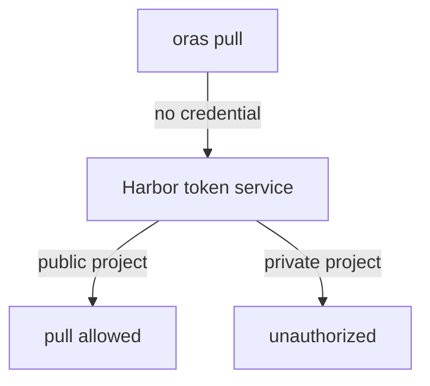

# Projects, Public And Private

Before you hand out roles, you need to know what a person gets with no role at all. That depends on one setting of the project: whether it is public or private. This part creates one project of each kind and tries to pull from both without signing in, so you see the difference before you read the rule.

## Your tools in the workstation

All Harbor tools in this course run in the `workstation` pod. A short helper saves typing: `ws` runs any command there. Define it once in each terminal you use:

<!-- astrona:playground:renew -->

```sh
ws() { kubectl -n workstation exec -i deploy/workstation -- "$@"; }
ws harbor version
```

The second command prints the version of the `harbor` command-line tool, `v0.0.27`. The `harbor` CLI is a client for Harbor's REST API: every command it runs is an HTTP request to `https://harbor.localtest.me:8443/api/v2.0/...`. Before it can send one, it needs a saved credential. Sign it in as the system administrator, `admin`, with the lab-only password:

```sh
echo Harbor12345 | ws harbor login https://harbor.localtest.me:8443 --username admin --password-stdin
ws harbor project list
```

`--password-stdin` reads the password from the standard input, so it never appears in your shell history. The CLI checks the password against Harbor and saves the credential, with the password encrypted, in the configuration file of the workstation. `harbor project list` then shows two projects: `library`, which every new Harbor creates, and `inventory`, which the playground created.

## A public and a private project

A **project** is the unit Harbor uses for access control and storage. Every repository lives in one project, and the project's name is the first part of every repository path: `harbor.localtest.me:8443/inventory/notes` is the repository `notes` in the project `inventory`. A project is either **public** or **private**:

| Kind | Who can pull | Who can push |
| --- | --- | --- |
| Public | Anyone, even a client that does not sign in | Members with a role that allows pushing |
| Private | Members only | Members with a role that allows pushing |

The difference is only about reading. Nobody pushes to a project without being a member, public or not. Create a public project next to the private `inventory`:

```sh
ws harbor project create demo-public --storage-limit -1 --public
ws harbor project view demo-public -o json
```

With `-o json`, the `view` command prints the project as JSON. Look for `metadata`: it holds `"public": "true"`. In `harbor project view inventory -o json`, the same field says `"false"`. Harbor stores the value as the text `"true"` or `"false"`, not as a JSON boolean, which matters when you read it with `jq`.

`--storage-limit -1` sets the project's storage quota to no limit. The `harbor` CLI (version 0.0.27) needs both a project name and `--storage-limit`; with only the name, it opens an interactive form, which fails when no terminal is attached.

## Pulling without signing in

Now see what the setting does. First push one small file to the public project as `admin`. The tool `oras` pushes any file as an OCI artifact, so you do not need Docker. `oras login` saves the credential in a file you name with `--registry-config`:

```sh
echo Harbor12345 | ws oras login --registry-config /tmp/admin.json -u admin --password-stdin harbor.localtest.me:8443
ws sh -c 'cd /tmp && echo hello > notes.txt && oras push --registry-config /tmp/admin.json harbor.localtest.me:8443/demo-public/notes:v1 notes.txt'
```

The push prints the digest of the new artifact. Now pull from both projects with an empty credential file, which is exactly what an anonymous client is:

```sh
ws sh -c 'mkdir -p /tmp/anon && cd /tmp/anon && oras pull --registry-config /tmp/none.json harbor.localtest.me:8443/demo-public/notes:v1'
ws sh -c 'mkdir -p /tmp/anon && cd /tmp/anon && oras pull --registry-config /tmp/none.json harbor.localtest.me:8443/inventory/notes:v1'
```

The first pull downloads `notes.txt`. The second fails: Harbor's token service gives an anonymous client no pull permission on a private project, so the registry answers that the client is not authorized. The error does not say whether the repository exists. That is on purpose: a private project does not reveal its content, not even its names, to someone who is not a member.



The diagram shows the decision for an anonymous client: Harbor's `core` component checks the project's visibility before it issues a pull token for the registry.

## Choosing the visibility

The rule follows from what you saw. Make a project public only when everyone who can reach the registry may read every artifact in it, for example base images that the whole company uses. Everything else is private, and access comes from membership. Making a project public to "fix" an access problem gives read access to everyone, including people who were never meant to see the images.

You can change the visibility later. `harbor project config update` changes project settings, and `--public false` makes the project private again:

```sh
ws harbor project config update demo-public --public false
ws harbor project view demo-public -o json
```

The `metadata` now holds `"public": "false"`, and the anonymous pull from `demo-public` fails the same way as the one from `inventory`.

You now know what a project is, how its visibility decides what an anonymous client can pull, and why private is the safe default. A private project with no members is useful only to the system administrator, though. The open question is how to let the right people in, each with the right rights, and that is what the five project roles are for.

## Common pitfalls

> [!WARNING]
> - **Making a project public to give one person access.** It gives read access to everyone who can reach Harbor. Add the person as a member instead.
> - **Thinking public means writable.** A public project only allows anonymous pulls. Pushing always needs a member with a push role.
> - **Reading `"public"` as a boolean.** Harbor stores project metadata as text, `"true"` or `"false"`. Compare it as text in `jq`.
> - **Reading an unauthorized pull as "the repository does not exist".** A private project gives the same answer for both, on purpose.
