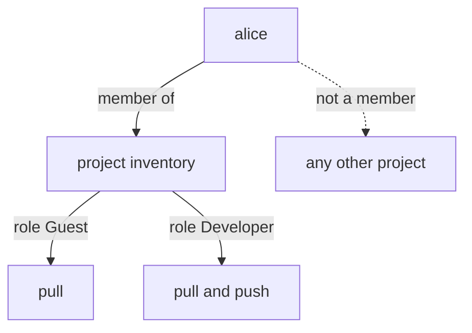

# Member Roles And What Each One May Do

A private project lets nobody in until you add **members**. Each member gets exactly one **role**, and the role decides what the member may do in that project and nothing else. Picking the role is the real access decision, so this part puts a user in a project with one role, tries a push, changes the role and tries again.

## The five roles

Harbor has five project roles. Each one adds rights to the one before it, so you can read the table from left to right as "more trust":

| Action in the project | Limited Guest | Guest | Developer | Maintainer | Project Admin |
| --- | --- | --- | --- | --- | --- |
| Pull artifacts | Yes | Yes | Yes | Yes | Yes |
| Push artifacts | No | No | Yes | Yes | Yes |
| Delete artifacts, start scans | No | No | No | Yes | Yes |
| Manage tag immutability rules | No | No | No | Yes | Yes |
| Add and remove members | No | No | No | No | Yes |
| Create robot accounts, delete the project | No | No | No | No | Yes |

**Limited Guest** can pull but sees little else of the project; it suits an outside party that needs one image and nothing more. **Guest** can pull and read the project, which suits an auditor or a consumer of images. **Developer** adds pushing, which is what a build pipeline or a developer needs. **Maintainer** adds deleting and scanning, for the person who cleans up and checks images. **Project Admin** manages the project itself, including its members.

One more role sits outside every project. A **system administrator**, such as `admin`, has every right in every project and also the system settings. Some project settings belong to the system administrator alone. The storage quota of a project is one of them: not even a Project Admin can raise it.

## Roles in the REST API

The `harbor` CLI and the web portal use role names. The REST API uses numbers, and you will meet both:

| Role ID | Role |
| --- | --- |
| 1 | Project Admin |
| 2 | Developer |
| 3 | Guest |
| 4 | Maintainer |
| 5 | Limited Guest |

The numbers are not in order of trust: Maintainer is 4 and Developer is 2. Always look the number up instead of guessing.

## One user, two roles

Now prove the difference between Guest and Developer with `alice`. Define the helper again if this is a new terminal, then add `alice` to `inventory` as a Guest:

<!-- astrona:playground:renew -->

```sh
ws() { kubectl -n workstation exec -i deploy/workstation -- "$@"; }
wst() { kubectl -n workstation exec -it deploy/workstation -- "$@"; }
ws harbor project member create inventory --username alice --roleid 2
wst harbor project member list inventory
```

The `harbor` CLI (version 0.0.27) draws lists and views as a table only on a terminal, so these commands run through `wst`, which adds `-t` (a terminal) to `kubectl exec`.

The list shows two members: `admin`, who created the project and is its Project Admin, and `alice` with the role Guest. Now sign `oras` in as `alice` and try to push:

```sh
echo AlicePass1 | ws oras login --registry-config /tmp/alice.json -u alice --password-stdin harbor.localtest.me:8443
ws sh -c 'cd /tmp && echo from-alice > alice.txt && oras push --registry-config /tmp/alice.json harbor.localtest.me:8443/inventory/notes:alice alice.txt'
```

The sign-in works, because `alice` is a valid user. The push fails: Harbor's token service gives a Guest a pull permission and no push permission, so the registry refuses the upload. Pulling the existing artifact as `alice` works, which you can check with `oras pull` and the same credential file.

Change the role to Developer. The `harbor` CLI (version 0.0.27) cannot change a role without a terminal: `harbor project member update` sends the user's ID where Harbor expects the ID of the membership. Use the REST API instead, with two helpers. `member_id` reads the membership ID from the member list, and `set_role` sends the real role number (`2` Developer, `3` Guest, `4` Maintainer).

```sh
member_id() { ws sh -c "curl -s -u admin:Harbor12345 https://harbor.localtest.me:8443/api/v2.0/projects/$1/members | jq -r '.[] | select(.entity_name == \"$2\") | .id'"; }
set_role() { ws curl -s -u admin:Harbor12345 -X PUT -H 'Content-Type: application/json' -d "{\"role_id\":$3}" "https://harbor.localtest.me:8443/api/v2.0/projects/$1/members/$(member_id "$1" "$2")"; }
set_role inventory alice 2
ws sh -c 'cd /tmp && oras push --registry-config /tmp/alice.json harbor.localtest.me:8443/inventory/notes:alice alice.txt'
```

The same push now succeeds, with the same credential. Nothing about `alice` changed; only her role in this one project did. In any other project, `alice` still has no rights at all.



The diagram shows that a role belongs to the pair of one user and one project: the same user can be a Developer in one project and have no access to another.

## The smallest role that works

The rule follows from the experiment: give each member the smallest role that lets them do their work. A build pipeline needs Developer, not Maintainer. A person who only reads images needs Guest. Only the person who manages the project's members needs Project Admin. A bigger role than needed does no harm on a normal day, and a lot of harm on the day a credential leaks.

You now know the five roles, their numbers in the REST API, and how to prove a role with a real push. The open question is how to set up a whole team this way without clicking through the web portal, and how to read the result back reliably.

## Common pitfalls

> [!WARNING]
> - **Guessing role numbers.** Developer is 2 and Maintainer is 4. Look them up.
> - **Giving Maintainer "to be safe".** Maintainer can delete artifacts. A pipeline that only pushes needs Developer.
> - **Expecting a role to apply everywhere.** A role belongs to one project. The same user has no rights in projects where they are not a member.
> - **Asking a Project Admin to raise a quota.** Only a system administrator can change a project's storage quota.
