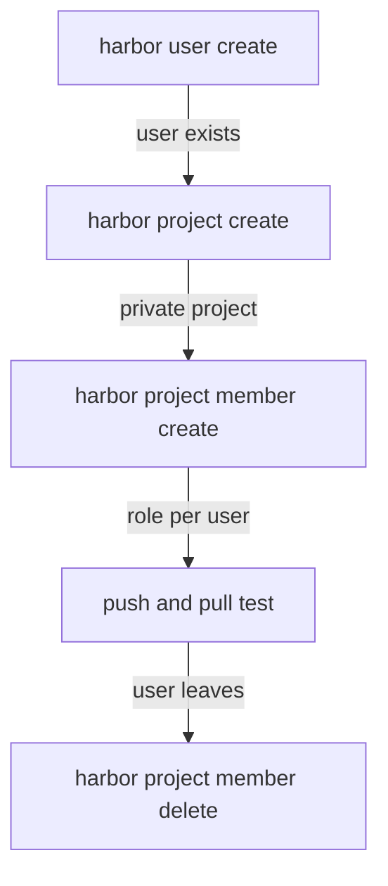

# Adding Members With The harbor CLI

Setting up one user by hand is easy. Setting up two teams, each with a developer and a shared auditor, takes several steps, and a missed step is a hole: a user left in the wrong project, or a project left public. This part builds a team project from the command line, reads the result back through the REST API, and removes a member again, so you can repeat the whole set-up and check it.

## Users and projects first

A member must exist before you can add it. In this playground the users live in Harbor's own database, the default **authentication mode**, so the system administrator creates them. The playground already has `alice`, `bob` and `carol`. Create one more user to see the command, then a private project for a team:

<!-- astrona:playground:renew -->

```sh
ws() { kubectl -n workstation exec -i deploy/workstation -- "$@"; }
wst() { kubectl -n workstation exec -it deploy/workstation -- "$@"; }
ws harbor user create --username dan --password DanPass1 --email dan@example.com --realname "Dan Example"
ws harbor project create team-x --storage-limit -1
ws harbor project view team-x -o json
```

`harbor project create` makes a private project unless you pass `--public`, and the `metadata` in the output shows `"public": "false"`. `--storage-limit -1` means no storage quota; without it, the CLI opens an interactive form instead of creating the project. Harbor's password rules ask for at least eight characters with an upper-case letter, a lower-case letter and a number, which is why the lab passwords look like `DanPass1`. The command line passes the password in plain text here; in a real script, read it from a secret store.

## Adding members

`harbor project member create` takes the project name, the user and the role as a number with `--roleid`. The `harbor` CLI (version 0.0.27) adds 1 to the `--roleid` number before it sends the request, so `--roleid 1` gives the Developer role, `--roleid 2` Guest, `--roleid 3` Maintainer and `--roleid 4` Limited Guest. The REST API's `role_id` is the real number: `1` Project Admin, `2` Developer, `3` Guest, `4` Maintainer and `5` Limited Guest. Check the role in the member list after you add someone.

The CLI also lists a `--role` flag for a role name, but it ignores that flag and opens an interactive form, which fails without a terminal. Give `dan` push rights and `carol` read rights:

```sh
ws harbor project member create team-x --username dan --roleid 1
ws harbor project member create team-x --username carol --roleid 2
wst harbor project member list team-x
```

The `harbor` CLI (version 0.0.27) draws lists and views as a table only on a terminal, so these commands run through `wst`, which adds `-t` (a terminal) to `kubectl exec`.

The list shows three members: `admin` as Project Admin, because the creator of a project becomes its Project Admin, `dan` as Developer and `carol` as Guest. The table is easy to read, but a script needs a stable format. Read the same list through the REST API, where each member is a JSON object with `entity_name`, `entity_type` (`u` for a user, `g` for a group) and `role_id`:

```sh
ws sh -c 'curl -s -u admin:Harbor12345 https://harbor.localtest.me:8443/api/v2.0/projects/team-x/members | jq -r ".[] | [.entity_name, .entity_type, .role_id] | @tsv"'
```

Each line shows one member: `admin u 1`, `dan u 2` and `carol u 3`. These are the same role numbers as before, 1 for Project Admin, 2 for Developer and 3 for Guest. The API call is what a grader or a pipeline would use, because its output does not change with the CLI's table layout.

## Changing and removing members

Roles change over time. A member who leaves a team must lose access at once, and the cleanest way is to remove the member, not to lower the role:

```sh
ws harbor project member delete team-x --username carol
wst harbor project member list team-x
```

`carol` is gone from the list, and a pull from `team-x` as `carol` now fails the same way as an anonymous pull. Her user still exists, with all her other memberships unchanged; only her membership of `team-x` is gone.



The diagram shows the order of a team set-up: users first, then a private project, then one membership per user, then a test as each user, and removal when someone leaves.

## Proving the set-up

Reading the member list proves what you configured, not what it allows. The proof is a push and a pull as each user. Sign `oras` in as `dan`, push to `team-x`, and try the same push to `inventory`, where `dan` is not a member:

```sh
echo DanPass1 | ws oras login --registry-config /tmp/dan.json -u dan --password-stdin harbor.localtest.me:8443
ws sh -c 'cd /tmp && echo from-dan > dan.txt && oras push --registry-config /tmp/dan.json harbor.localtest.me:8443/team-x/notes:v1 dan.txt'
ws sh -c 'cd /tmp && oras push --registry-config /tmp/dan.json harbor.localtest.me:8443/inventory/notes:dan dan.txt'
```

The first push succeeds and the second fails. That pair of results, one allowed and one refused, is the real evidence that `dan`'s access stops at his own project.

You can now create users and private projects, add members with the right role, read them back in a stable format, remove them, and prove each user's access. That is everything you need to set up two isolated teams with a shared auditor.

## Common pitfalls

> [!WARNING]
> - **Writing role names with a space.** The CLI expects `Project_Admin` and `Limited_Guest`, with an underscore.
> - **Lowering a role instead of removing a member.** A Guest can still pull. Remove the member when the person should have no access.
> - **Trusting the member list alone.** It shows the configuration. A push and a pull as the user prove what it allows.
> - **Forgetting that the creator is a member.** The user who creates a project becomes its Project Admin.

## Your mission: Isolate Two Teams With Projects And Roles

You can now create private projects, give each user the smallest role that works, and prove the result with pushes and pulls. The graded lab gives you three users and asks you to build two isolated team projects with one shared, read-only auditor.

The lab runs in its own cluster, so first pause your playground. Nothing in it is lost:

```sh
astrona stop ats-101-playground-010-01
```

Then start the lab:

```sh
astrona run --git ssh://git@github.com/astrona-io/ATS101.git -c sections/section-010/module-01/labs/lab-01
```

The task is on the next page. Solve it on your own first. When you think you are done, send it for grading:

```sh
astrona submit -c sections/section-010/module-01/labs/lab-01
```

When the lab is done, remove it and start your playground again:

```sh
astrona destroy ats-101-lab-010-01
astrona start ats-101-playground-010-01
```
