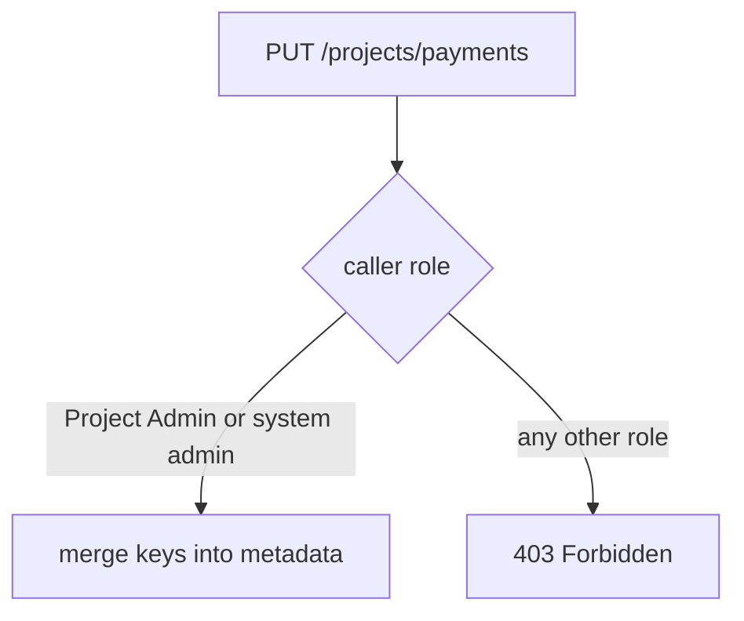

# Project Metadata And The Project API

Before you can change a project's rules, you must know where Harbor keeps them and how to change one rule without losing the others. This part reads a project through the REST API, lists the metadata keys, and changes one key with a partial update.

## Reading a project

A project is an object with a name, a numeric `project_id`, an owner and a `metadata` map. Read `payments` as the administrator. The path accepts the project name or the numeric ID:

<!-- astrona:playground:renew -->

```sh
ws() { kubectl -n workstation exec -i deploy/workstation -- "$@"; }
ws sh -c 'curl -s -u admin:Harbor12345 https://harbor.localtest.me:8443/api/v2.0/projects/payments | jq "{name, project_id, metadata, cve_allowlist}"'
```

The answer shows the project name, its ID, the metadata map and the project CVE allowlist. On a new project the metadata holds only `public` with the value `"false"`, because Harbor stores a key only after somebody sets it. A key that is missing means the default.

## The metadata keys

The keys that matter for security are these:

| Key | Values | What it does |
| --- | --- | --- |
| `public` | `"true"`, `"false"` | Anonymous clients may pull when it is `"true"` |
| `auto_scan` | `"true"`, `"false"` | Scan every artifact when it is pushed |
| `prevent_vul` | `"true"`, `"false"` | Refuse the pull of an artifact that has serious vulnerabilities |
| `severity` | `"low"`, `"medium"`, `"high"`, `"critical"` | The lowest severity that `prevent_vul` blocks |
| `reuse_sys_cve_allowlist` | `"true"`, `"false"` | Use the system CVE allowlist for this project |
| `enable_content_trust_cosign` | `"true"`, `"false"` | Serve only artifacts with a cosign signature |
| `enable_content_trust` | `"true"`, `"false"` | The same for Notary signatures, an older signing system |
| `retention_id` | a number | The retention policy of the project, managed by Harbor |

Two keys belong together. `prevent_vul` switches the blocking on, and `severity` says from which level it applies. Setting only one of them gives an incomplete policy.

## A partial update

The project is changed with a `PUT` to the same path. Harbor merges the keys you send into the stored metadata, so you send only the keys you change. Save this as `payments-auto-scan.json`:

```json
{ "metadata": { "auto_scan": "true" } }
```

Send it, then read the metadata again:

```sh
ws curl -s -u admin:Harbor12345 -X PUT -H 'Content-Type: application/json' --data-binary @- https://harbor.localtest.me:8443/api/v2.0/projects/payments < payments-auto-scan.json
ws sh -c 'curl -s -u admin:Harbor12345 https://harbor.localtest.me:8443/api/v2.0/projects/payments | jq .metadata'
```

The metadata now holds `auto_scan` with the value `"true"` next to `public`. The value must be the string `"true"`. Harbor rejects a JSON boolean in this map.

## Who may change the metadata

Project Admins can change these settings in their own project, and system administrators can change them everywhere. A Maintainer, Developer or Guest cannot. Prove it with `bob`, who is Guest of `payments`:

```sh
ws curl -s -o /dev/null -w '%{http_code}\n' -u bob:BobPass1 -X PUT -H 'Content-Type: application/json' --data-binary @- https://harbor.localtest.me:8443/api/v2.0/projects/payments < payments-auto-scan.json
```

Harbor answers `403`. The same request from `alice`, the Project Admin, succeeds. A permission check always happens first, so the answer does not depend on the value you send.



The diagram shows the order: Harbor core checks the role of the caller, and only then merges the keys.

You now know where a project keeps its rules, which keys exist and how to change one key. The open question is what Harbor does when `auto_scan` is on, and how a scan result can stop a pull.

## Common pitfalls

> [!WARNING]
> - **Sending a JSON boolean.** Metadata values are strings: send `"true"`, not `true`.
> - **Setting `prevent_vul` without `severity`.** The policy is incomplete and its effect is not what you expect.
> - **Expecting a missing key to be an error.** A key that is missing means the default value.
> - **Changing metadata as a Maintainer.** Only Project Admins and system administrators can; everyone else gets `403`.
