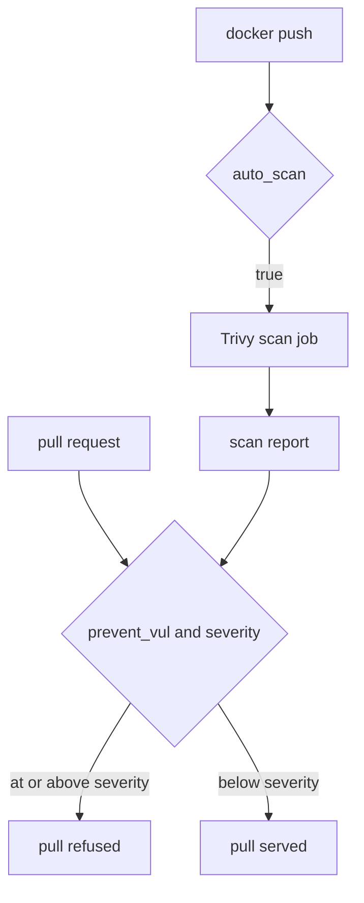

# Vulnerability Scanning And Pull Blocking

An image can contain software with known vulnerabilities. Harbor cannot fix them, but it can scan every image when it arrives and refuse to serve the ones that are too risky. This part explains what Harbor scans, when it scans, and how a project turns the scan result into a pull rule.

## What a scan does

A **vulnerability scanner** compares the packages inside an image with a database of known vulnerabilities. Each finding has a CVE identifier and a **severity**: `low`, `medium`, `high` or `critical`. Harbor does not scan by itself. It hands the work to a **scanner adapter**, and Trivy is the default adapter that ships with the Harbor chart. The Harbor jobservice component runs the scan job and stores the report.

A scan applies to images, not to every kind of artifact. A file pushed with `oras` is an artifact with no packages in it, so it has nothing to scan. The scan result of an image is visible in the portal and through the API, and it is attached to the artifact digest.

## Automatic scanning

Without `auto_scan`, somebody must start every scan by hand. With `auto_scan` set to `"true"`, Harbor starts a scan job as soon as an image is pushed to the project. Turn it on for `payments`:

<!-- astrona:playground:renew -->

```json
{ "metadata": { "auto_scan": "true" } }
```

Save the lines above as `payments-auto-scan.json` and send them:

```sh
ws() { kubectl -n workstation exec -i deploy/workstation -- "$@"; }
ws curl -s -u admin:Harbor12345 -X PUT -H 'Content-Type: application/json' --data-binary @- https://harbor.localtest.me:8443/api/v2.0/projects/payments < payments-auto-scan.json
```

A project that does not use `auto_scan` can still scan on demand. The API call is `POST /projects/{project}/repositories/{repository}/artifacts/{reference}/scan`, and the `harbor` CLI wraps it. Automatic scanning removes the human step.

## Blocking the pull

A scan result is only a report until a rule uses it. The rule is the pair `prevent_vul` and `severity`. When `prevent_vul` is `"true"`, Harbor refuses to serve an image whose scan found a vulnerability at the chosen severity or above. The check happens when a client pulls, so the push still works and the image stays in the project.

Choose the severity with care. At `critical`, Harbor blocks only the worst findings, and most images still pull. At `low`, almost every image is blocked, because almost every image has a low finding. Many teams start with `high`. Save this as `payments-block-high.json`:

```json
{ "metadata": { "auto_scan": "true", "prevent_vul": "true", "severity": "high" } }
```

```sh
ws curl -s -u admin:Harbor12345 -X PUT -H 'Content-Type: application/json' --data-binary @- https://harbor.localtest.me:8443/api/v2.0/projects/payments < payments-block-high.json
ws sh -c 'curl -s -u admin:Harbor12345 https://harbor.localtest.me:8443/api/v2.0/projects/payments | jq .metadata'
```

The metadata now holds the three keys as strings. A client that pulls an image with a `high` or `critical` finding from `payments` gets an error from the registry instead of the image. The error comes from Harbor core, not from the client.

## What the rule does not do

The rule does not delete anything, and it does not stop the push. It also acts on the scan result that exists at the time of the pull. When Trivy's database learns about a new vulnerability, an old scan result stays the same until the image is scanned again. That is why teams rescan on a schedule.



The diagram shows two separate moments: the scan runs at push time, and the decision happens at pull time using the stored report.

You now know that a project can scan on push and refuse risky pulls. The open question is what to do when a vulnerability is known and accepted, so that an important image can still be pulled.

## Common pitfalls

> [!WARNING]
> - **Expecting the push to fail.** `prevent_vul` blocks the pull, not the push.
> - **Setting the severity to `low`.** Almost every image has a low finding, so almost every pull is blocked.
> - **Relying on an old scan.** A report does not change when new vulnerabilities are published; scan again.
> - **Scanning a non-image artifact.** A file pushed with `oras` has no packages to scan.
