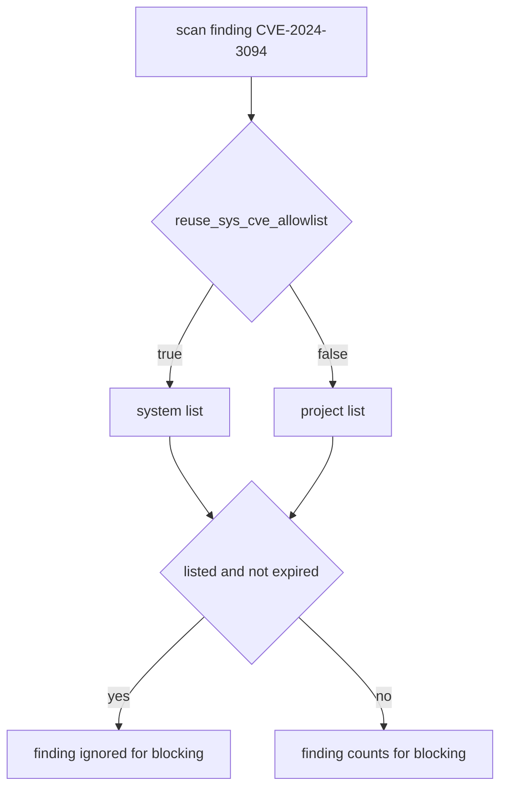

# The CVE Allowlist

Pull blocking sometimes stops an image that a team has to deploy today. The vulnerability may not be reachable in that application, or the fix may not exist yet. Harbor lets an administrator accept specific vulnerabilities, so that pull blocking ignores them while it still blocks every other finding.

## What the allowlist is

A **CVE allowlist** is a list of CVE identifiers that Harbor ignores when it applies the pull-blocking rule. An identifier has the form `CVE-2024-3094`: the letters CVE, the year and a number. Each entry can have an expiry time, after which Harbor stops ignoring it. The scan report keeps listing the vulnerability. Only the blocking decision ignores it.

There are two lists. The **system allowlist** is one list for the whole registry, kept by system administrators. The **project allowlist** belongs to one project. Which list a project uses is decided by the metadata key `reuse_sys_cve_allowlist`. With `"true"`, the project uses the system list and its own list is ignored. With `"false"`, the project uses its own list.

## Reading the system list

The system list is part of the Harbor configuration endpoint of the API. Read it as the administrator:

<!-- astrona:playground:renew -->

```sh
ws() { kubectl -n workstation exec -i deploy/workstation -- "$@"; }
ws sh -c 'curl -s -u admin:Harbor12345 https://harbor.localtest.me:8443/api/v2.0/system/CVEAllowlist | jq .'
```

A new Harbor returns an empty `items` list and an `expires_at` that is empty or zero. The list is read-only for everyone who is not a system administrator.

## Writing a project list

A project list is written with the same project update that changes the metadata. The `cve_allowlist` field is a sibling of `metadata`, not part of it. Save this as `payments-allowlist.json`:

```json
{
  "metadata": { "reuse_sys_cve_allowlist": "false" },
  "cve_allowlist": {
    "items": [ { "cve_id": "CVE-2024-3094" } ]
  }
}
```

The file switches the project to its own list and puts one CVE in it. Send it and read the project back:

```sh
ws curl -s -u admin:Harbor12345 -X PUT -H 'Content-Type: application/json' --data-binary @- https://harbor.localtest.me:8443/api/v2.0/projects/payments < payments-allowlist.json
ws sh -c 'curl -s -u admin:Harbor12345 https://harbor.localtest.me:8443/api/v2.0/projects/payments | jq "{reuse: .metadata.reuse_sys_cve_allowlist, items: .cve_allowlist.items}"'
```

The answer lists `CVE-2024-3094` and shows `reuse` as `"false"`. The list you send replaces the stored list, so send every entry you want to keep. An empty `items` list removes all entries.

## Expiry and review

An entry that never expires hides a risk for ever. The `expires_at` field of the list is a Unix time in seconds, and it applies to the whole list. When the time passes, Harbor behaves as if the list were empty, and blocked images become blocked again. Choose a date that matches the time the team needs to fix the problem.



The diagram shows that the key `reuse_sys_cve_allowlist` picks the list, and the list decides whether one finding counts.

You now know how to accept a vulnerability for one project, and why the choice between the two lists matters. The open question is how to know that an image is the one your team built, and not only that it is free of known vulnerabilities.

## Common pitfalls

> [!WARNING]
> - **Leaving `reuse_sys_cve_allowlist` at `"true"`.** The project list is then ignored and the entry has no effect.
> - **Writing one entry and losing the others.** The list you send replaces the stored list.
> - **An allowlist without an expiry.** The risk is hidden for ever and nobody reviews it.
> - **Expecting the report to change.** The scan report still shows the vulnerability; only the blocking ignores it.
