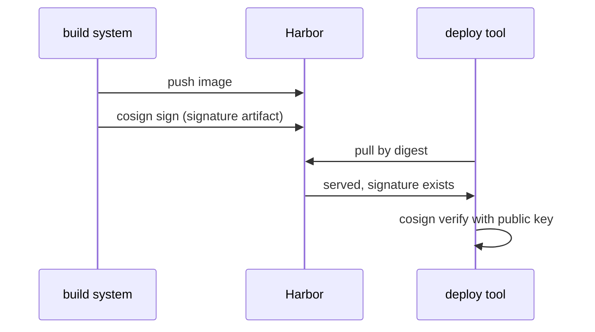

# Content Trust With Cosign

A scan says what is inside an image. It does not say who built it. Anyone with push rights could push an image with the same name and a different content. A **signature** closes that gap: the build system signs the image digest with a private key, and Harbor refuses to serve images without a valid signature.

## What a signature is in Harbor

**Cosign** is a command-line tool of the Sigstore project that signs OCI artifacts. When you sign an image, cosign computes a signature over the image digest and pushes the signature to the same repository as a separate artifact. Harbor shows the signature as an accessory of the image, which is an artifact that belongs to another artifact.

Harbor does not hold the private key and does not sign anything. It only checks that a cosign signature exists for the digest being pulled. The project key for this check is `enable_content_trust_cosign`. The older key `enable_content_trust` does the same job for Notary signatures, a signing system that cosign replaces.

## Turning the check on

The rule is one metadata key. Save this as `payments-cosign.json`:

<!-- astrona:playground:renew -->

```json
{ "metadata": { "enable_content_trust_cosign": "true" } }
```

Send it as the administrator and read the metadata back:

```sh
ws() { kubectl -n workstation exec -i deploy/workstation -- "$@"; }
ws curl -s -u admin:Harbor12345 -X PUT -H 'Content-Type: application/json' --data-binary @- https://harbor.localtest.me:8443/api/v2.0/projects/payments < payments-cosign.json
ws sh -c 'curl -s -u admin:Harbor12345 https://harbor.localtest.me:8443/api/v2.0/projects/payments | jq .metadata.enable_content_trust_cosign'
```

The answer is `"true"`. From now on, a pull of an image without a cosign signature is refused. A pull by digest follows the same rule, because the check is on the digest, not on the tag.

## Signing an image

Signing happens outside Harbor, on the build machine. With a key pair made by `cosign generate-key-pair`, the command signs the digest of a pushed image:

```sh
cosign sign --key cosign.key harbor.localtest.me:8443/payments/web@sha256:<DIGEST>
```

Replace `<DIGEST>` with the digest of your image, which `oras` or `harbor` prints at push time. Always sign the digest. A tag can move to another image after you sign it. Harbor lists the signature under the image in the portal, and a pull of that digest then works.

## What the check proves and what it does not

The check proves that a signature exists for the digest. It does not check which key made the signature. Anybody who can push to the project can also push a signature made with their own key. For a strong guarantee, verify the signature with your own public key when you deploy: `cosign verify --key cosign.pub <image>`. Harbor's check is the first gate and the deploy-time check is the second.



The diagram shows the two gates: Harbor serves only signed digests, and the deploy tool verifies the signature with its own key.

You now know how a project serves only signed images, and where Harbor's check stops. With scanning, pull blocking, the allowlist and signatures, you can set a complete security policy for one project.

## Common pitfalls

> [!WARNING]
> - **Signing a tag.** Tags move; always sign the digest.
> - **Believing Harbor checks the key.** It checks only that a cosign signature exists; verify the key at deploy time.
> - **Turning the rule on for existing unsigned images.** Pulls of those images stop at once.
> - **Mixing up the two keys.** `enable_content_trust_cosign` is for cosign; `enable_content_trust` is for Notary.

## Your mission: Apply A Security Policy To A Project

You can now read project metadata, turn on scanning, block risky pulls, accept one vulnerability and require signatures. The graded lab asks you to set a complete policy on the project `payments` with the REST API and to leave it visible only to its members.

The lab runs in its own cluster, so first pause your playground. Nothing in it is lost:

```sh
astrona stop ats-101-playground-010-03
```

Then start the lab:

```sh
astrona run --git ssh://git@github.com/astrona-io/ATS101.git -c sections/section-010/module-03/labs/lab-01
```

The task is on the next page. Solve it on your own first. When you think you are done, send it for grading:

```sh
astrona submit -c sections/section-010/module-03/labs/lab-01
```

When the lab is done, remove it and start your playground again:

```sh
astrona destroy ats-101-lab-010-03
astrona start ats-101-playground-010-03
```
