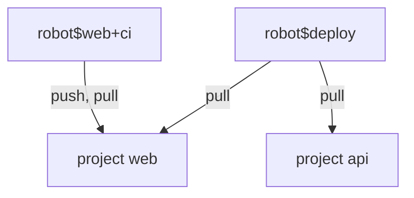

# Permissions: Resources, Actions And Scope

A robot account has no roles. Instead it has a list of permissions, each one a pair of a resource and an action, inside a scope. This part explains the pieces, shows how they differ from the five member roles, and creates a read-only robot that covers two projects.

## Resources and actions

A **resource** is a kind of object in Harbor, such as `repository`, `artifact`, `tag`, `scan` or `helm-chart`. An **action** is what the robot may do to that kind of object, such as `pull`, `push`, `create`, `delete`, `list` or `read`. Not every action exists for every resource. Harbor lists the valid pairs for a project in the portal when you create a robot, and it rejects a pair that does not exist.

The pairs you use most often are these:

| Resource | Action | What the robot may do |
| --- | --- | --- |
| `repository` | `pull` | Pull artifacts from the project |
| `repository` | `push` | Push artifacts to the project |
| `repository` | `delete` | Delete a repository |
| `artifact` | `delete` | Delete an artifact |
| `tag` | `create` | Add a tag to an artifact |
| `tag` | `delete` | Remove a tag from an artifact |
| `scan` | `create` | Start a vulnerability scan |

A pipeline that builds and pushes needs `repository` `push`, and usually `pull` as well, because a push to a registry often starts with a check that reads. A cleanup job needs `artifact` `delete`. A deployment tool needs only `repository` `pull`.

## Roles compared with permissions

A member role such as Developer bundles many actions that a person may want. A robot has no bundle. If the list does not name an action, the robot cannot do it. This is the point: the permission list is the whole policy, so reading it tells you exactly what a leaked secret could do. A Developer can create tags and start scans, and a robot with only `push` and `pull` cannot.

## System robots and scope

A system robot account lists permissions by project. The body uses one entry per project in `permissions`, or the namespace `*` to cover every project, including projects created later. Save this as `robot-deploy.json`, a read-only robot for the projects `web` and `api`:

<!-- astrona:playground:renew -->

```json
{
  "name": "deploy",
  "description": "Pulls images for deployment",
  "level": "system",
  "duration": 90,
  "disable": false,
  "permissions": [
    { "kind": "project", "namespace": "web", "access": [ { "resource": "repository", "action": "pull" } ] },
    { "kind": "project", "namespace": "api", "access": [ { "resource": "repository", "action": "pull" } ] }
  ]
}
```

Send it as the administrator:

```sh
ws() { kubectl -n workstation exec -i deploy/workstation -- "$@"; }
ws curl -s -u admin:Harbor12345 -X POST -H 'Content-Type: application/json' --data-binary @- https://harbor.localtest.me:8443/api/v2.0/robots < robot-deploy.json
```

The answer holds the name `robot$deploy` and its secret. Only a system administrator can create a system robot, because it reaches across projects. A Project Admin can create project robots in their own project.

## Reading the permissions back

The list endpoint returns the permissions with each robot. Read them for the new robot, with `jq` to show the scope:

```sh
ws sh -c 'curl -s -u admin:Harbor12345 "https://harbor.localtest.me:8443/api/v2.0/robots?page_size=100" | jq ".[] | select(.name==\"robot\$deploy\") | .permissions"'
```

The output shows two entries, one for `web` and one for `api`, each with the access `repository` `pull`. The same list for `robot$web+ci` shows one entry for `web` with `push` and `pull`.



The diagram shows that the project robot reaches one project, and the system robot reaches two, each with its own list of actions.

You now know the parts of a robot permission and the difference between the two levels. The open question is how a client uses the secret, and how to prove that the limits hold.

## Common pitfalls

> [!WARNING]
> - **Granting `delete` to a pipeline that only pushes.** A leaked secret could then remove artifacts.
> - **Using the namespace `*` when two projects are enough.** A new project is covered at once, without anybody deciding that.
> - **Expecting a robot to inherit a role.** A robot has only the actions in its list.
> - **Creating a system robot when a project robot is enough.** Keep the scope as small as the job.
