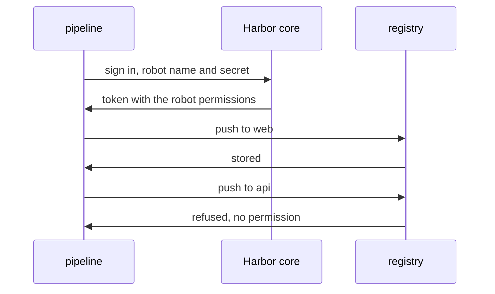

# Using A Robot Account In A Pipeline

A robot account only proves its value when a client uses it and the limits hold. This part signs `oras` in with a robot, pushes where it may, and shows the refusals where it may not.

## Signing in

A registry client signs in with the full robot name as the user name and the secret as the password. `oras`, `docker`, `regctl` and `cosign` all use that pair. Take the secret from the create call and store it in a shell variable on the workstation for this session. Quote the name:

<!-- astrona:playground:renew -->

```sh
ws() { kubectl -n workstation exec -i deploy/workstation -- "$@"; }
echo '<SECRET>' | ws oras login --registry-config /tmp/ci.json -u 'robot$web+ci' --password-stdin harbor.localtest.me:8443
```

Replace `<SECRET>` with the secret from the earlier create call. The `--registry-config` option keeps this sign-in in its own file, so it does not mix with other users. The command prints that the login succeeded.

## Pushing where the robot may

The robot has `repository` `push` in `web`. Push a small file:

```sh
ws sh -c 'cd /tmp && date > build.txt && oras push --registry-config /tmp/ci.json harbor.localtest.me:8443/web/app:build-1 build.txt'
```

The push succeeds. Harbor core checked the token the registry client received, saw the robot's permission for the project `web`, and let the registry store the artifact.

## The refusals

Push the same file to the other project, where the robot has no permission:

```sh
ws sh -c 'cd /tmp && oras push --registry-config /tmp/ci.json harbor.localtest.me:8443/api/app:build-1 build.txt'
```

The registry refuses the push with an authorization error. The sign-in itself worked, because the secret is valid. What failed is the permission check for the project `api`. This is the difference between authentication, which checks who the client is, and authorization, which checks what it may do.

The robot also cannot delete. Try to delete the artifact it just pushed:

```sh
ws curl -s -o /dev/null -w '%{http_code}\n' -u 'robot$web+ci:<SECRET>' -X DELETE https://harbor.localtest.me:8443/api/v2.0/projects/web/repositories/app/artifacts/build-1
```

Harbor answers `403`, because `artifact` `delete` is not in the list. Replace `<SECRET>` as before.

## What robots cannot do

Robot accounts are for registry clients and the API, not for the portal. They cannot change their own permissions or create other robots. They also do not count as project members, so a project's member list does not show them. You find them in the robot list of the project and in the system robot list.

## Where the audit log shows the robot

Every push and pull is logged with the user name that did it. For this pipeline the name in the log is `robot$web+ci`, not a person. That makes a review easy: all actions of the pipeline are one name, and all actions of people are theirs.



The diagram shows that the token carries the permissions, so the registry can refuse a push to a project that is not in the list.

You now know how a pipeline signs in with a robot, and you have seen the limits hold for another project and for deletes. The open question is how long a robot should live and how to replace a secret that leaked.

## Common pitfalls

> [!WARNING]
> - **Using the short name `ci`.** The sign-in uses the full name `robot$web+ci`.
> - **Reading a refused push as a wrong secret.** A valid secret with a missing permission is also refused; check the permission list.
> - **Putting the secret on a command line in a shared system.** Use `--password-stdin` or the secret store of the pipeline.
> - **Looking for robots in the member list.** They are in the robot list, not among members.
