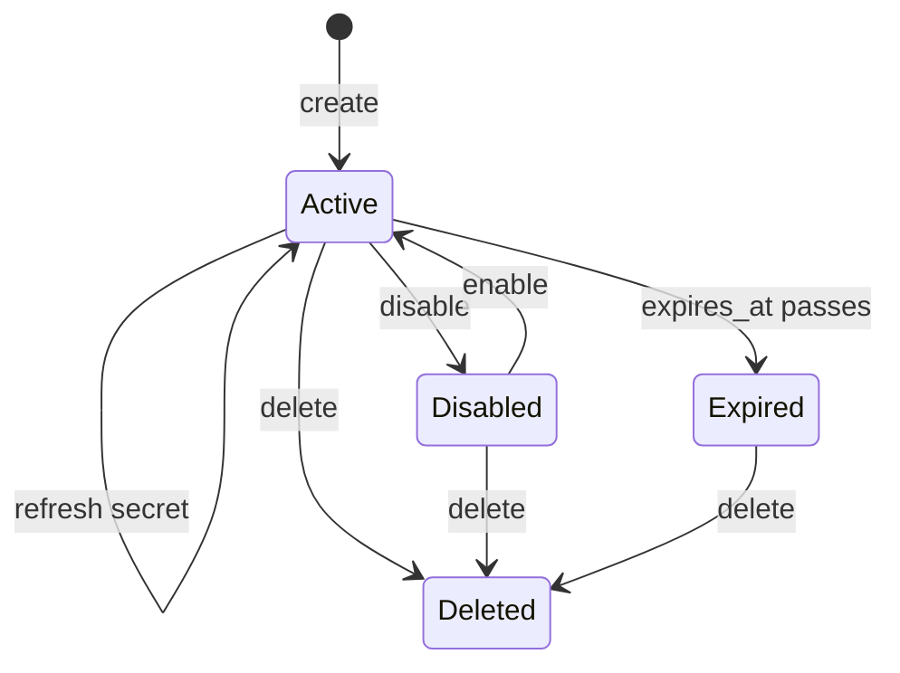

# Operating Robot Accounts

A robot account is a long-lived secret, and long-lived secrets leak. This part covers what Harbor offers to limit the damage: expiry, a new secret, a disabled account and removal. It also covers how an administrator finds robots that nobody remembers.

## Expiry

The `duration` field sets the lifetime in days, counted from the moment of creation. Harbor stores the end as the Unix time `expires_at`. When the time passes, the secret stops working. The robot account still exists in the list. Choose a duration that fits the rotation habit of the team, such as 30 or 90 days, and avoid `-1`.

An administrator can also change the system default lifetime with the configuration key `robot_token_duration`, a number of days. Read it:

<!-- astrona:playground:renew -->

```sh
ws() { kubectl -n workstation exec -i deploy/workstation -- "$@"; }
ws sh -c 'curl -s -u admin:Harbor12345 https://harbor.localtest.me:8443/api/v2.0/configurations | jq "{robot_token_duration, robot_name_prefix}"'
```

The answer shows two keys. `robot_token_duration` is the default lifetime of a robot in days, and `robot_name_prefix` is the prefix `robot$`. Both are system settings, so only a system administrator changes them.

## Refreshing a secret

When a secret leaks, or when the team rotates secrets, replace it without recreating the robot, so the permissions and the history stay. The call is a `PATCH` to the robot with the new secret in the body. Save this as `robot-secret.json`, with a secret of at least eight characters that has a lowercase letter, an uppercase letter and a digit:

```json
{ "secret": "NewCiSecret2026" }
```

Find the ID of the robot in the list, then send the file, using the ID in place of `<ROBOT_ID>`:

```sh
ws sh -c 'curl -s -u admin:Harbor12345 "https://harbor.localtest.me:8443/api/v2.0/robots?page_size=100" | jq ".[] | {id, name}"'
ws curl -s -u admin:Harbor12345 -X PATCH -H 'Content-Type: application/json' --data-binary @- https://harbor.localtest.me:8443/api/v2.0/robots/<ROBOT_ID> < robot-secret.json
```

The old secret stops working at once, and a client that still holds it gets an authentication error at the next sign-in.

## Disabling and deleting

The `disable` field turns a robot off without deleting it. The portal shows a switch for it. A disabled robot keeps its name and permissions but cannot sign in. Disabling is the right first step when you are not sure whether something still uses the robot, because you can enable it again.

Deleting removes the robot for good. The call is `DELETE /robots/<ROBOT_ID>`:

```sh
ws curl -s -o /dev/null -w '%{http_code}\n' -u admin:Harbor12345 -X DELETE https://harbor.localtest.me:8443/api/v2.0/robots/<ROBOT_ID>
```

Harbor answers with a success code. The name cannot be used to sign in any more, and the permission list is gone.

## A review routine

A short routine keeps robots under control. List all robots with their `level`, `duration`, `expires_at` and permissions. Look for robots that never expire, robots with `delete` that only push, and robots with the namespace `*`. Compare the names with the pipelines that exist. Disable what you cannot explain, wait for complaints, and then delete.



The diagram shows the life of a robot: it is active until it is disabled, expires or is deleted, and a refresh keeps it active with a new secret.

You now know how to limit a robot in time, replace its secret, switch it off and remove it. With the permission list and the review routine, you can run automation access without shared personal passwords.

## Common pitfalls

> [!WARNING]
> - **Deleting before disabling.** If you are wrong, the pipeline fails and you must recreate the robot and its permissions.
> - **Rotating without updating the pipeline.** The old secret stops working at once.
> - **Forgetting that an expired robot still exists.** It stays in the list until you delete it.
> - **Letting robots live for ever.** Set a duration and review the list.

## Your mission: Create And Clean Up Robot Accounts

You can now create a project robot, choose its permissions, prove its limits and remove robots you do not need. The graded lab asks you to create a robot with exactly the permissions a pipeline needs and to remove an old robot that has too many.

The lab runs in its own cluster, so first pause your playground. Nothing in it is lost:

```sh
astrona stop ats-101-playground-010-04
```

Then start the lab:

```sh
astrona run --git ssh://git@github.com/astrona-io/ATS101.git -c sections/section-010/module-04/labs/lab-01
```

The task is on the next page. Solve it on your own first. When you think you are done, send it for grading:

```sh
astrona submit -c sections/section-010/module-04/labs/lab-01
```

When the lab is done, remove it and start your playground again:

```sh
astrona destroy ats-101-lab-010-04
astrona start ats-101-playground-010-04
```
