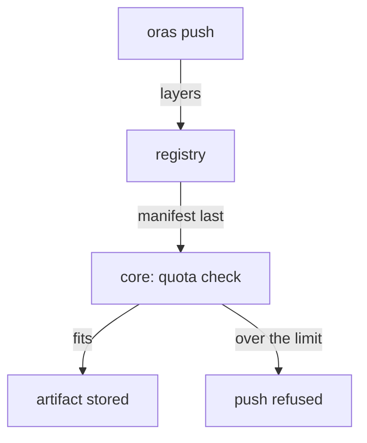

# Storage Quotas

Retention rules keep a project tidy, but rules can be wrong or missing. A storage quota is the safety net under them: whatever happens, the project cannot grow past its limit. This part reads how much `inventory` stores, sets a small quota, and pushes a file that does not fit.

## How Harbor counts storage

Every artifact is made of blobs: one manifest plus the layers or files it refers to. Harbor computes a project's usage from the blobs pushed into it. A blob that two artifacts in the same project share counts **once** for that project. The same blob in two different projects counts once in each, so the total of all projects can be more than the disk really holds.

A **storage quota** is the most bytes a project may store. By default every project has no limit, shown as `-1`. Only a **system administrator** can set or change a quota; a Project Admin cannot, which stops a team from raising its own limit.

## Reading the current usage

The `harbor` CLI lists every project's quota with its limit and its usage. Define the helper, sign the CLI in, and look at `inventory`:

<!-- astrona:playground:renew -->

```sh
ws() { kubectl -n workstation exec -i deploy/workstation -- "$@"; }
echo Harbor12345 | ws harbor login https://harbor.localtest.me:8443 --username admin --password-stdin
ws harbor quota list
```

Each row is one project. The row for `inventory` shows the limit as unlimited and a small usage, a few kilobytes, because the seven artifacts are tiny text files. The REST API gives the same numbers in bytes, which is what a script compares:

```sh
ws sh -c 'id=$(curl -s -u admin:Harbor12345 https://harbor.localtest.me:8443/api/v2.0/projects/inventory | jq .project_id); curl -s -u admin:Harbor12345 "https://harbor.localtest.me:8443/api/v2.0/quotas?reference=project&reference_id=$id" | jq ".[0] | {hard, used}"'
```

`hard.storage` is the limit, `-1` for unlimited, and `used.storage` is the usage in bytes.

## Setting a quota

Set a limit of 20 MiB on `inventory`. `harbor quota update` takes the project name and a size with a unit such as `MiB` or `GiB`:

```sh
ws harbor quota update --project-name inventory --storage 20MiB
ws harbor quota list
```

The row for `inventory` now shows a limit of 20 MiB. In the REST API, `hard.storage` is `20971520`, which is 20 × 1024 × 1024 bytes.

## A push that does not fit

Now push a file that is bigger than the whole quota. `head -c` makes a 30 MiB file of random bytes, and `oras` pushes it:

```sh
echo Harbor12345 | ws oras login --registry-config /tmp/admin.json -u admin --password-stdin harbor.localtest.me:8443
ws sh -c 'cd /tmp && head -c 31457280 /dev/urandom > big.bin && oras push --registry-config /tmp/admin.json harbor.localtest.me:8443/inventory/blob:big big.bin'
```

The push fails, and the error from Harbor says the quota is exceeded. The system administrator is no exception: the quota belongs to the project, not to the user. A small file still fits:

```sh
ws sh -c 'cd /tmp && head -c 1048576 /dev/urandom > small.bin && oras push --registry-config /tmp/admin.json harbor.localtest.me:8443/inventory/blob:small small.bin'
```

That push succeeds, and `ws harbor quota list` shows the usage about 1 MiB higher.



The diagram shows the order of a push: the layers go first and the manifest last, and Harbor checks the quota when it records the blobs and the manifest, so a push over the limit can fail at the very end.

## What a quota does not do

A quota refuses new pushes; it never deletes anything. When a project is full, someone must remove artifacts, and deleted blobs give their space back only after Harbor's **garbage collection** runs and removes blobs that no artifact uses any more. Raising the quota is a decision for the system administrator, not a fix for a project that never cleans up. That cleanup is the job of tag retention.

You now know how Harbor counts storage, how to read and set a project's quota, and what a push over the quota looks like. The open question is how to keep a project under its quota without deleting artifacts by hand.

## Common pitfalls

> [!WARNING]
> - **Expecting the quota to delete old artifacts.** A quota only refuses pushes. Retention rules and garbage collection free space.
> - **Adding up project usage to size the disk.** A blob shared by two projects counts in both, so the sum can be more than the disk holds.
> - **Asking a Project Admin to raise the quota.** Only a system administrator can change it.
> - **Reading a late failure as a network problem.** A push over the quota can upload every layer and then fail on the manifest.
