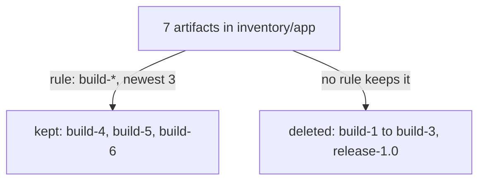

# Tag Retention Rules

A quota stops a project from growing, but something still has to delete the old builds. Deleting them by hand does not scale, and it is easy to delete the wrong tag. A **tag retention rule** describes which artifacts to keep; when the project's retention policy runs, Harbor deletes every artifact that no rule keeps. This part writes one rule, checks it with a dry run, and runs it.

## Keep, not delete

Retention rules are written the other way round from what many people expect: each rule says what to **keep**. Everything in the project that no rule keeps is deleted when the policy runs. A rule has three parts:

| Part | What it decides | Example |
| --- | --- | --- |
| Repositories | Which repositories the rule looks at, matching or excluding a pattern | matching `**` (all repositories) |
| Tags | Which tags the rule looks at, matching or excluding a pattern | matching `build-*` |
| Template | Which of those artifacts to keep | the 3 most recently pushed |

Harbor has five templates: keep the most recently pushed N artifacts, the most recently pulled N, those pushed within the last N days, those pulled within the last N days, or always keep. Patterns accept `*` for any characters within a name and `**` for anything. A project may have up to 15 rules, and they combine with **OR**: an artifact survives if any rule keeps it. All rules of a project share one schedule.

## Writing the rule

The goal for `inventory/app` is to keep the three newest builds. The `harbor` CLI has no flag for a template such as "the 3 most recently pushed", so this page uses the REST API. A retention policy belongs to one project and needs the project's numeric ID. Read it:

<!-- astrona:playground:renew -->

```sh
ws() { kubectl -n workstation exec -i deploy/workstation -- "$@"; }
ws sh -c 'curl -s -u admin:Harbor12345 https://harbor.localtest.me:8443/api/v2.0/projects/inventory | jq .project_id'
```

The command prints one number, the project ID. Save the policy below as `retention-inventory.json`, and replace `<PROJECT_ID>` with that number:

```json
{
  "algorithm": "or",
  "rules": [
    {
      "disabled": false,
      "action": "retain",
      "template": "latestPushedK",
      "params": { "latestPushedK": 3 },
      "tag_selectors": [
        { "kind": "doublestar", "decoration": "matches", "pattern": "build-*" }
      ],
      "scope_selectors": {
        "repository": [
          { "kind": "doublestar", "decoration": "repoMatches", "pattern": "**" }
        ]
      }
    }
  ],
  "trigger": { "kind": "Schedule", "settings": { "cron": "" } },
  "scope": { "level": "project", "ref": <PROJECT_ID> }
}
```

`latestPushedK` with `3` is the template "keep the 3 most recently pushed". The tag selector looks only at tags that match `build-*`, and the scope selector looks at every repository. An empty `cron` means the policy has no schedule and runs only when someone starts it. Create the policy:

```sh
ws curl -s -u admin:Harbor12345 -H 'Content-Type: application/json' --data-binary @- https://harbor.localtest.me:8443/api/v2.0/retentions < retention-inventory.json
ws sh -c 'curl -s -u admin:Harbor12345 https://harbor.localtest.me:8443/api/v2.0/projects/inventory | jq .metadata.retention_id'
```

`ws` passes the file from your machine to `curl` in the workstation as the standard input. Harbor links the new policy to the project, and the project's `metadata.retention_id` now holds the policy's ID.

## A dry run first

A retention run cannot be undone, so start with a **dry run**: Harbor works out what it would delete and deletes nothing. Start one, using the retention ID from the last command in place of `<RETENTION_ID>`:

```sh
ws curl -s -u admin:Harbor12345 -H 'Content-Type: application/json' -d '{"dry_run":true}' https://harbor.localtest.me:8443/api/v2.0/retentions/<RETENTION_ID>/executions
ws sh -c 'curl -s -u admin:Harbor12345 "https://harbor.localtest.me:8443/api/v2.0/retentions/<RETENTION_ID>/executions?page_size=1" | jq ".[0] | {id, status, dry_run}"'
```

The second command shows the newest execution: `dry_run` is `true`, and `status` turns to a finished state after a few seconds. Each execution has one task per repository, and each task records how many artifacts it looked at and how many it kept. Read the task of the dry run, using the execution `id` in place of `<EXECUTION_ID>`:

```sh
ws sh -c 'curl -s -u admin:Harbor12345 https://harbor.localtest.me:8443/api/v2.0/retentions/<RETENTION_ID>/executions/<EXECUTION_ID>/tasks | jq ".[] | {repository, total, retained}"'
```

The task for `app` says seven artifacts in total and three retained. That is the surprise of this page: the rule keeps `build-4`, `build-5` and `build-6`, and **`release-1.0` is not kept by any rule**, so a real run would delete it together with `build-1` to `build-3`.



The diagram shows why the release would go: retention keeps only what a rule selects, and the one rule selects builds only.

## Running it for real

Do not run the policy yet. A second rule that keeps `release-*` artifacts with the template "always keep" would fix it, and so would protecting releases with an immutability rule. Both are valid; the second one also stops anyone from overwriting a release, which is why it is the better habit. When the releases are safe, a real run is the same call with `"dry_run":false`, and the tags left in `app` show the result:

```sh
ws sh -c 'curl -s -u admin:Harbor12345 "https://harbor.localtest.me:8443/api/v2.0/projects/inventory/repositories/app/artifacts?with_tag=true" | jq -r ".[].tags[]?.name" | sort'
```

Today that list still shows all seven tags, because only a dry run has happened.

You now know that retention rules say what to keep, how templates and patterns select artifacts, how rules combine, and how a dry run shows the result without deleting anything. The open question is how to protect the release from this rule and from every other way a release could be lost.

## Common pitfalls

> [!WARNING]
> - **Writing a rule for what to delete.** Every rule says what to keep. Anything no rule keeps is deleted.
> - **Skipping the dry run.** A real run cannot be undone. Read the dry run's task counts first.
> - **Expecting space back at once.** Retention deletes artifacts; the storage comes back after garbage collection.
> - **Giving each rule its own schedule.** All rules of a project share one schedule.
