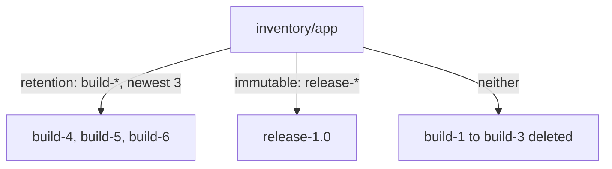

# Tag Immutability Rules

A release tag is a promise: `release-1.0` today must be exactly the artifact it was yesterday. Two things break that promise. Someone pushes a new artifact with the same tag by mistake, and the tag now points at different content. Or a retention run deletes the release because no rule kept it. A **tag immutability rule** stops both: a matching tag can never be overwritten, re-tagged or deleted.

## Writing the rule

An immutability rule has the same shape as a retention rule: a repository selector and a tag selector, each matching or excluding a pattern. It has no template, because it does not choose a number of artifacts; every matching tag becomes immutable. A project may have up to 15 immutability rules, and they combine with **OR**. Making tags immutable needs the role Maintainer or Project Admin.

Save this rule as `immutable-release.json`. It makes every `release-*` tag in every repository of the project immutable:

<!-- astrona:playground:renew -->

```json
{
  "disabled": false,
  "action": "immutable",
  "template": "immutable_template",
  "tag_selectors": [
    { "kind": "doublestar", "decoration": "matches", "pattern": "release-*" }
  ],
  "scope_selectors": {
    "repository": [
      { "kind": "doublestar", "decoration": "repoMatches", "pattern": "**" }
    ]
  }
}
```

Create it for `inventory` through the REST API, then list the project's rules:

```sh
ws() { kubectl -n workstation exec -i deploy/workstation -- "$@"; }
wst() { kubectl -n workstation exec -it deploy/workstation -- "$@"; }
ws curl -s -u admin:Harbor12345 -H 'Content-Type: application/json' --data-binary @- https://harbor.localtest.me:8443/api/v2.0/projects/inventory/immutabletagrules < immutable-release.json
ws sh -c 'curl -s -u admin:Harbor12345 https://harbor.localtest.me:8443/api/v2.0/projects/inventory/immutabletagrules | jq ".[] | {id, disabled, pattern: .tag_selectors[0].pattern}"'
```

The list shows one enabled rule with the pattern `release-*`. The `harbor` CLI can list these rules too, with `wst harbor tag immutable list`, but it creates them through questions on the terminal, which is why this page uses the REST API.

The `harbor` CLI (version 0.0.27) draws lists and views as a table only on a terminal, so these commands run through `wst`, which adds `-t` (a terminal) to `kubectl exec`.

## What the rule stops

Try to overwrite the release. Push a new file with the tag `release-1.0`:

```sh
echo Harbor12345 | ws oras login --registry-config /tmp/admin.json -u admin --password-stdin harbor.localtest.me:8443
ws sh -c 'cd /tmp && echo changed > note.txt && oras push --registry-config /tmp/admin.json harbor.localtest.me:8443/inventory/app:release-1.0 note.txt'
```

The push fails, and Harbor's error says the tag is immutable. Even the system administrator cannot move the tag. Deleting the release through the REST API fails the same way:

```sh
ws curl -s -o /dev/null -w '%{http_code}\n' -u admin:Harbor12345 -X DELETE https://harbor.localtest.me:8443/api/v2.0/projects/inventory/repositories/app/artifacts/release-1.0
```

The answer is an error code, not `200`, and the artifact is still there. A new tag such as `release-1.1` can still be pushed once; after that, it is immutable too, because it matches the pattern.

## Immutability and retention together

Immutability also protects a tag from retention. A retention run never deletes an immutable artifact, even when no retention rule keeps it. That is exactly the gap a "keep the newest 3 builds" rule leaves open: the builds rotate, and the releases survive because they are immutable. If the project has a retention policy with the rule `build-*`, newest 3, a real run now leaves four tags:



The diagram shows the result of one retention run with both kinds of rule: retention keeps the newest builds, immutability keeps the release, and only the old builds are deleted.

You can check this the same way as before: a dry run of the retention policy, then the task counts, then a real run, then the list of tags. With the quota as the last line of defence, `inventory` now cleans itself up and never loses a release.

You now know how to make tags immutable, what that stops, and how immutability and retention combine. Together with a quota, these three tools keep a project within its storage budget without manual cleanup.

## Common pitfalls

> [!WARNING]
> - **Protecting releases with a second retention rule only.** It stops retention from deleting them, but anyone with push rights can still overwrite the tag. Immutability stops both.
> - **Making `**` immutable.** Every tag, including `latest` and every build, can then never be deleted or moved, and retention can free nothing.
> - **Expecting a Developer to create the rule.** Immutability rules need Maintainer or Project Admin.
> - **Trying to "fix" an immutable tag by re-pushing.** It is refused. Push a new tag instead.

## Your mission: Keep A Project Within Its Storage Budget

You can now set a quota, write a retention rule, check it with a dry run, and protect releases with an immutability rule. The graded lab gives you a project full of builds and one release, and asks you to put all three tools in place so a retention run leaves exactly the right tags.

The lab runs in its own cluster, so first pause your playground. Nothing in it is lost:

```sh
astrona stop ats-101-playground-020-01
```

Then start the lab:

```sh
astrona run --git ssh://git@github.com/astrona-io/ATS101.git -c sections/section-020/module-01/labs/lab-01
```

The task is on the next page. Solve it on your own first. When you think you are done, send it for grading:

```sh
astrona submit -c sections/section-020/module-01/labs/lab-01
```

When the lab is done, remove it and start your playground again:

```sh
astrona destroy ats-101-lab-020-01
astrona start ats-101-playground-020-01
```
