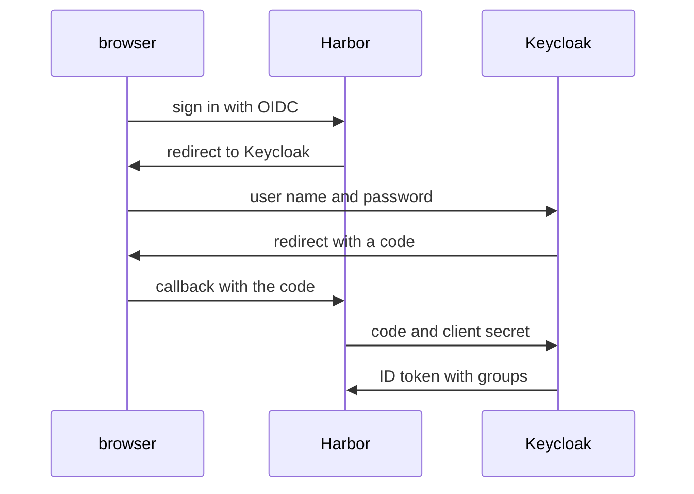

# Authentication Modes And When You Can Change Them

Before Harbor can sign anyone in through Keycloak, it has to stop checking passwords in its own database. That switch is a one-way door in practice: Harbor only lets you change it while nobody but `admin` exists. This part reads Harbor's current mode, checks the condition, and looks at what Keycloak publishes for Harbor to use.

## Where Harbor checks passwords

The **authentication mode** decides where Harbor checks a user's name and password. There are four:

| Mode | Value in the API | Who checks the password |
| --- | --- | --- |
| Database | `db_auth` | Harbor itself, against its own user table (the default) |
| LDAP | `ldap_auth` | An LDAP or Active Directory server |
| OIDC | `oidc_auth` | An OpenID Connect provider, through the browser |
| HTTP authentication proxy | `http_auth` | A web service in front of Harbor |

The mode is a system setting, so it lives in Harbor's configuration, not in a project. Read it through the REST API. Each setting comes back as an object with a `value` and an `editable` flag:

<!-- astrona:playground:renew -->

```sh
ws() { kubectl -n workstation exec -i deploy/workstation -- "$@"; }
ws sh -c 'curl -s -u admin:Harbor12345 https://harbor.localtest.me:8443/api/v2.0/configurations | jq .auth_mode'
```

The answer shows `value` `db_auth` and `editable` `true`. `editable` tells you whether the mode can still be changed. The `harbor` CLI reads the same system settings with `ws harbor config view`; the REST API is used here because its JSON is easy to filter.

## The rule for changing the mode

Harbor's documentation states the condition plainly: you can change the authentication mode from database to OIDC, or to LDAP, **only if no local users have been added to the database**. The `admin` account does not count. As soon as one other user exists, `editable` turns to `false`, and the only way back is to remove those users.

The reason is identity. A local user `alice` and an OIDC user `alice` would be two different people with the same name, and the second one could inherit the first one's memberships. Harbor avoids that by allowing the switch only on a clean system. List the users to see that this Harbor is clean:

```sh
ws sh -c 'curl -s -u admin:Harbor12345 "https://harbor.localtest.me:8443/api/v2.0/users" | jq -r ".[].username"'
```

The list holds one name, `admin`. That is why the playground creates no local users in this module, and why every change of mode on a real system is planned before the first user appears.

## What Keycloak publishes

An OIDC provider publishes a **discovery document** at `/.well-known/openid-configuration` under its **issuer**, the URL that identifies the provider. Harbor reads it to find every endpoint it needs, so the only address you give Harbor is the issuer. For the Keycloak realm `harbor`, the issuer is `http://keycloak.localtest.me:8180/realms/harbor`. Read the document from the workstation:

```sh
ws sh -c 'curl -s http://keycloak.localtest.me:8180/realms/harbor/.well-known/openid-configuration | jq "{issuer, authorization_endpoint, token_endpoint}"'
```

The `issuer` is exactly the URL you asked under, and the two endpoints are where Harbor sends the browser and where Harbor exchanges the code for tokens. The same address works in your browser through `kubectl -n keycloak port-forward svc/keycloak 8180:8180`. That matters: the issuer inside every token must match what Harbor expects, so the browser and Harbor must reach Keycloak under the same name.



The diagram shows an OIDC sign-in: the password only ever goes to Keycloak, and Harbor receives an ID token that it exchanged for the code, using the client secret.

You now know Harbor's four modes, how to read the current one, why the switch is allowed only on a clean system, and where Keycloak publishes what Harbor needs. The open question is which settings Harbor needs to complete the sign-in in the diagram.

## Common pitfalls

> [!WARNING]
> - **Creating a local user "just to test" before switching.** It blocks the change of mode until you remove the user.
> - **Giving Harbor the discovery URL instead of the issuer.** Harbor wants the issuer and adds `/.well-known/openid-configuration` itself.
> - **Reaching Keycloak under two names.** The issuer in the token must match. Use the same address in the browser and in Harbor.
> - **Reading `editable: false` as a permission problem.** It means local users exist.
