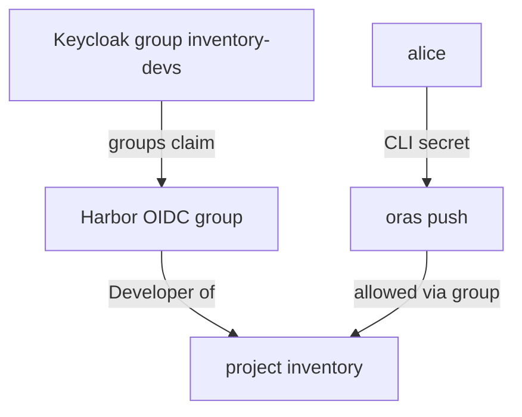

# OIDC Groups, The Admin Group And CLI Secrets

Signing users in is half the job. If every user still needs a project membership of their own, nothing has improved: someone must still add and remove people by hand in Harbor. The point of connecting an identity provider is that its **groups** decide access. This part makes a Keycloak group a project member, makes another group Harbor administrators, and signs `oras` in, which cannot use a browser.

## Groups in the ID token

Keycloak puts the user's groups into the ID token, in the claim `groups`, because the `harbor` client has a group membership mapper. Harbor reads the claim named in its **groups claim** setting, here `groups`. When a user signs in, Harbor records each group in the claim as an **OIDC group**, and the user counts as a member of every project where one of those groups is a member.

Add the group `inventory-devs` to the project `inventory` as Developer. A group member needs a group type; OIDC groups are type `3` (type `1` is an LDAP group):

<!-- astrona:playground:renew -->

```sh
ws() { kubectl -n workstation exec -i deploy/workstation -- "$@"; }
echo Harbor12345 | ws harbor login https://harbor.localtest.me:8443 --username admin --password-stdin
ws harbor project member create inventory --groupname inventory-devs --grouptype 3 --role Developer
ws sh -c 'curl -s -u admin:Harbor12345 https://harbor.localtest.me:8443/api/v2.0/projects/inventory/members | jq -r ".[] | [.entity_name, .entity_type, .role_id] | @tsv"'
```

The REST API lists `inventory-devs` with the entity type `g`, for group, and role `2`, Developer. `alice` is in that group in Keycloak, so she can push to `inventory` from her next sign-in on, and nobody had to add her by name. When she leaves the group in Keycloak, she loses the access at her next sign-in.

## The admin group

One group can also make its members Harbor **system administrators**. Harbor calls it the **admin group**, and you can set only one. Set it to `platform-admins`, where `bob` is a member. A `PUT` with one key changes only that key:

```sh
ws curl -s -u admin:Harbor12345 -X PUT -H 'Content-Type: application/json' -d '{"oidc_admin_group":"platform-admins"}' https://harbor.localtest.me:8443/api/v2.0/configurations
```

When `bob` signs in through the browser, Harbor sees `platform-admins` in his `groups` claim and gives him administrator rights. His Harbor user record shows them in the field `admin_role_in_auth`, which means the rights come from the identity provider, not from a setting in Harbor's database.

## CLI secrets

A browser can follow the redirects to Keycloak; `oras`, `docker` and `regctl` cannot. For them Harbor gives every OIDC user a **CLI secret**: a long random password that registry clients send with the user name. Each user has one CLI secret at a time, and creating a new one makes the old one stop working.

Get `alice`'s CLI secret. With both port-forwards from the browser sign-in still running, sign out `carol`, sign in as `alice` with `AlicePass1`, open the user menu in the top right corner, and choose **User Profile**. The profile shows the CLI secret with a button to copy it. Then sign `oras` in with the user name and the secret, and push:

```sh
echo '<CLI_SECRET>' | ws oras login --registry-config /tmp/alice.json -u alice --password-stdin harbor.localtest.me:8443
ws sh -c 'cd /tmp && date > note.txt && oras push --registry-config /tmp/alice.json harbor.localtest.me:8443/inventory/notes:alice note.txt'
```

Replace `<CLI_SECRET>` with the copied value. The push succeeds, because `alice` is in `inventory-devs`, which is Developer of `inventory`. `carol` can get a CLI secret the same way, but her push to `inventory` is refused, because she is in no group with access.



The diagram shows the chain behind `alice`'s push: Keycloak's group reaches Harbor in the token, the group is a project member, and the CLI secret lets `oras` act as `alice`.

The CLI secret only works while Harbor can still refresh the user's OIDC session. If the refresh fails, for example because the user was disabled in Keycloak, the secret stops working until the user signs in through the browser again. That is how disabling a person in Keycloak also ends their command-line access.

You can now give access through groups, make one group Harbor administrators, and sign registry clients in with a CLI secret. Together with the OIDC settings, that is everything you need to run Harbor's access control from Keycloak.

## Common pitfalls

> [!WARNING]
> - **Adding OIDC users one by one as members.** Add the group instead; access then follows the group in Keycloak.
> - **A groups claim name that does not match the mapper.** Harbor finds no groups, and every group membership is silently ignored.
> - **Using the Keycloak password with `oras`.** Registry clients need the CLI secret.
> - **Expecting more than one admin group.** Harbor accepts exactly one.

## Your mission: Connect Harbor To Keycloak And Map A Group

You can now switch Harbor to OIDC, test the endpoint, map a group to a project role and set the admin group. The graded lab gives you a Harbor still on database authentication and a prepared Keycloak, and asks you to make a group of Keycloak users Developers of a project and another group Harbor administrators.

The lab runs in its own cluster, so first pause your playground. Nothing in it is lost:

```sh
astrona stop ats-101-playground-030-01
```

Then start the lab:

```sh
astrona run --git ssh://git@github.com/astrona-io/ATS101.git -c sections/section-030/module-01/labs/lab-01
```

The task is on the next page. Solve it on your own first. When you think you are done, send it for grading:

```sh
astrona submit -c sections/section-030/module-01/labs/lab-01
```

When the lab is done, remove it and start your playground again:

```sh
astrona destroy ats-101-lab-030-01
astrona start ats-101-playground-030-01
```
