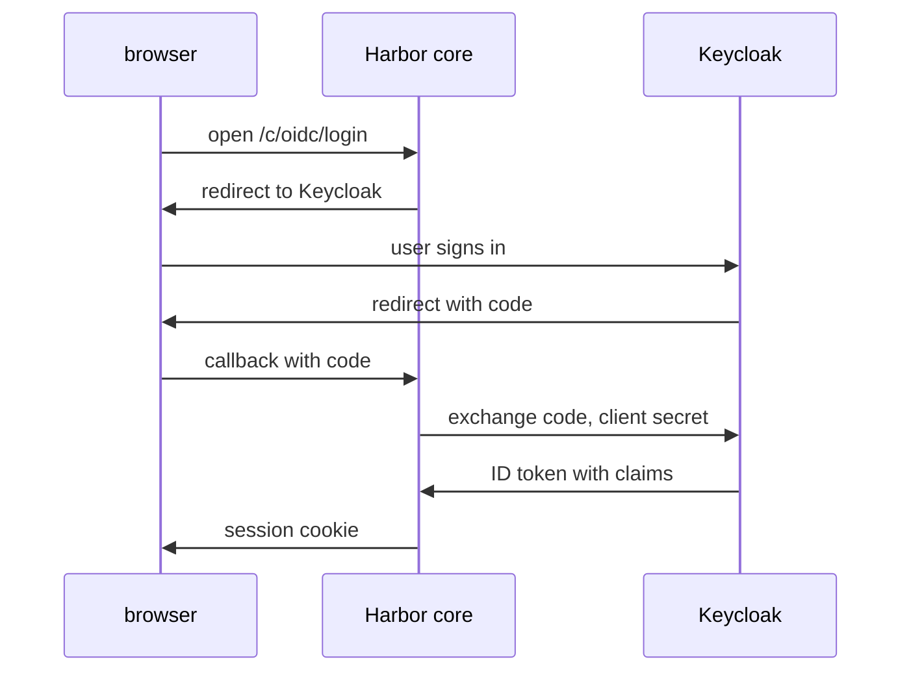

# What Harbor Reads From The ID Token

Every sign-in decision in Harbor starts from facts that the provider sends. If you do not know which facts Harbor reads, you cannot tell whether a failure is in Harbor, in the provider or in the mapping between them. This part reads the provider's discovery document, lists the claims Harbor needs, and shows how Harbor recognises a user who returns.

## The discovery document

An OIDC provider publishes its settings at a fixed address, the issuer address plus `/.well-known/openid-configuration`. The document is JSON. Read the parts Harbor uses:

<!-- astrona:playground:renew -->

```sh
ws() { kubectl -n workstation exec -i deploy/workstation -- "$@"; }
ws sh -c 'curl -s http://keycloak.localtest.me:8180/realms/harbor/.well-known/openid-configuration | jq "{issuer, authorization_endpoint, token_endpoint, jwks_uri}"'
```

The answer shows four addresses. The **issuer** is the name the provider puts in every token it signs, and Harbor compares it with the endpoint you configured. The **authorization endpoint** is where Harbor sends the browser. The **token endpoint** is where Harbor exchanges the code for tokens. The **JWKS address** (JSON Web Key Set) holds the public keys that Harbor uses to check the token signature. If the issuer in the document and the endpoint in Harbor differ by one character, sign-in fails.

## The claims Harbor needs

Harbor reads three groups of claims from the ID token:

| Claim | Harbor setting | What Harbor does with it |
| --- | --- | --- |
| `sub` and `iss` | none, always used | Identify the user, together |
| `preferred_username` | `oidc_user_claim` | Becomes the Harbor user name at onboarding |
| `groups` | `oidc_groups_claim` | Lists the groups of the user |
| `email` | none | Is stored as the user's email address |

The **subject** (`sub`) is an identifier that the provider never reuses for another person. The **issuer** (`iss`) is the provider's name. Harbor stores the pair as the field `subiss` of the OIDC user record. At the next sign-in, Harbor finds the user by that pair, and not by the user name. That is why a user name that changes in the provider does not create a second Harbor user.

## What Harbor stores

Harbor keeps a record for each OIDC user: the pair `subiss`, the CLI secret and the times of creation and update. After `alice` has signed in once, the record exists. Read it as `alice`, using her CLI secret in place of `<CLI_SECRET>`; she copies it from the user profile in the portal after she signs in:

```sh
ws sh -c 'curl -s -u alice:<CLI_SECRET> https://harbor.localtest.me:8443/api/v2.0/users/current | jq "{username, oidc_user_meta: (.oidc_user_meta | {subiss, creation_time})}"'
```

The answer shows her user name and the `subiss`, which is the subject and the issuer joined together. The secret field is also in the record, and you should not print it in shared logs.

## Where the groups come from

Keycloak writes the groups into the claim `groups` because the client has a group membership mapper. If the mapper is missing, or writes a different claim name, Harbor receives no groups. Check the groups of a user on the provider side, with Keycloak's administration tool in the Keycloak pod:

```sh
kcadm() { kubectl -n keycloak exec -i deploy/keycloak -- /opt/keycloak/bin/kcadm.sh "$@" --config /tmp/kcadm.config; }
kcadm config credentials --server http://localhost:8080 --realm master --user admin --password admin
kcadm get users -r harbor -q username=alice --fields id,username
```

Take the `id` from the answer and list the groups with `kcadm get users/<USER_ID>/groups -r harbor --fields name`. The result is what the mapper can put into the token. The Keycloak console can also show the exact token: in the client's **Client scopes** tab, the **Evaluate** page generates an example ID token for a chosen user.



The diagram shows where each claim arrives: Harbor core receives the ID token from the token endpoint, never from the browser.

You now know which claims Harbor reads, how it recognises a returning user and where to check the groups. The open question is how groups become different levels of access in one project.

## Common pitfalls

> [!WARNING]
> - **Assuming Harbor matches users by name.** It matches by subject and issuer; the name is set at onboarding.
> - **A groups claim name that differs from the mapper.** Harbor sees no groups and does not report an error.
> - **Mixing up issuer and authorization endpoint.** The endpoint in Harbor's settings is the issuer.
> - **Printing the user record in a shared log.** It contains the CLI secret.
