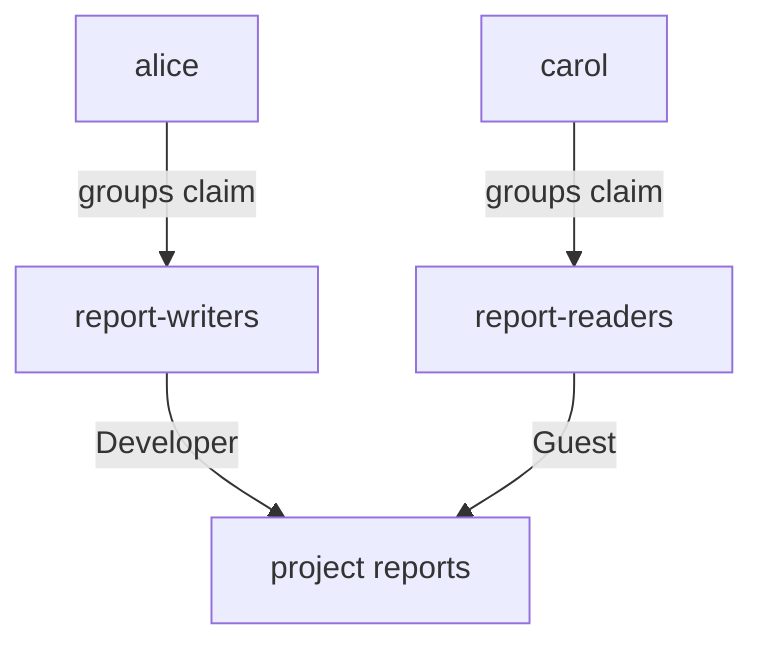

# Designing Group To Role Mappings

Giving a group access to a project is easy. Giving several groups the right different levels in the same project, and keeping the result understandable, takes a design. This part adds two groups to one project with two roles, explains how Harbor treats a group, and proves the difference with real pushes and pulls.

## How a group enters Harbor

Harbor does not copy groups from the provider. A group appears in Harbor when an administrator adds it as a project member by name, or when a user whose token holds it signs in. The record has a name and a type. The type for an OIDC group is `3`. You can list every group Harbor knows with the REST API:

<!-- astrona:playground:renew -->

```sh
ws() { kubectl -n workstation exec -i deploy/workstation -- "$@"; }
ws sh -c 'curl -s -u admin:Harbor12345 https://harbor.localtest.me:8443/api/v2.0/usergroups | jq -r ".[] | [.id, .group_name, .group_type] | @tsv"'
```

A new playground returns an empty list, because no group is a member of anything yet. The ID of a group is what you use to read or delete it.

## Two roles in one project

The project `reports` should be writable by the writers and readable by the readers. Writers need the Developer role, which can push and pull. Readers need the Guest role, which can pull and cannot push. Harbor identifies roles by number: `2` is Developer and `3` is Guest. Save this as `member-writers.json`:

```json
{ "role_id": 2, "member_group": { "group_name": "report-writers", "group_type": 3 } }
```

Save this as `member-readers.json`:

```json
{ "role_id": 3, "member_group": { "group_name": "report-readers", "group_type": 3 } }
```

Send both to the members endpoint of the project, and read the list back:

```sh
ws curl -s -u admin:Harbor12345 -X POST -H 'Content-Type: application/json' --data-binary @- https://harbor.localtest.me:8443/api/v2.0/projects/reports/members < member-writers.json
ws curl -s -u admin:Harbor12345 -X POST -H 'Content-Type: application/json' --data-binary @- https://harbor.localtest.me:8443/api/v2.0/projects/reports/members < member-readers.json
ws sh -c 'curl -s -u admin:Harbor12345 https://harbor.localtest.me:8443/api/v2.0/projects/reports/members | jq -r ".[] | [.id, .entity_name, .entity_type, .role_id] | @tsv"'
```

The list has two lines with the entity type `g`. The first group has role `2` and the second has role `3`. Neither group needed to exist in Harbor before. Harbor created both records when you added them.

## Changing and removing a mapping

The member `id` in that list is the key for changes. A `PUT` to `/projects/reports/members/<MEMBER_ID>` with `{"role_id": 3}` changes the role, and a `DELETE` removes the group from the project. Removing a member removes the project access of everyone who got it through that group, at once. The group record itself stays in Harbor, so the list of groups does not shrink.

## When a change in the provider reaches Harbor

Harbor reads the groups of a user from the token at each sign-in. It does not ask the provider again during the session. So when you move `carol` from `report-readers` to `report-writers` in Keycloak, Harbor knows nothing until she signs in through the browser again. The reverse holds, too: a person removed from a group keeps the access until the session ends. When you need an immediate effect, remove the project member in Harbor, or disable the user in the provider.

## One group per project

A person can be in several groups. If two groups that are both members of the same project give different roles, the person holds the rights of both, and the result is hard to explain. Keep it simple: give each person one group per project, and name the groups after the role, such as `report-writers`, not after the team.



The diagram shows that the groups connect users to roles in the project, so a person's rights follow from the group in the token.

You now know how to give two groups different levels of access in one project, and when a change in the provider takes effect. The graded lab applies this together with the admin group.

## Common pitfalls

> [!WARNING]
> - **Expecting an instant effect.** Group changes in the provider reach Harbor at the next sign-in.
> - **Using a group type of `1`.** Type `1` is for LDAP groups; OIDC groups are type `3`.
> - **Putting a person in two groups of the same project.** The combined rights are hard to predict.
> - **Naming groups after teams.** Name them after the access they give.

## Your mission: Give Two Keycloak Groups Different Roles

You can now map groups to roles and know when a change takes effect. The graded lab gives you a Harbor that already signs in through Keycloak and asks you to give two groups different roles in the project `reports`, and to make a third group the Harbor administrators.

The lab runs in its own cluster, so first pause your playground. Nothing in it is lost:

```sh
astrona stop ats-101-playground-030-02
```

Then start the lab:

```sh
astrona run --git ssh://git@github.com/astrona-io/ATS101.git -c sections/section-030/module-02/labs/lab-01
```

The task is on the next page. Solve it on your own first. When you think you are done, send it for grading:

```sh
astrona submit -c sections/section-030/module-02/labs/lab-01
```

When the lab is done, remove it and start your playground again:

```sh
astrona destroy ats-101-lab-030-02
astrona start ats-101-playground-030-02
```
