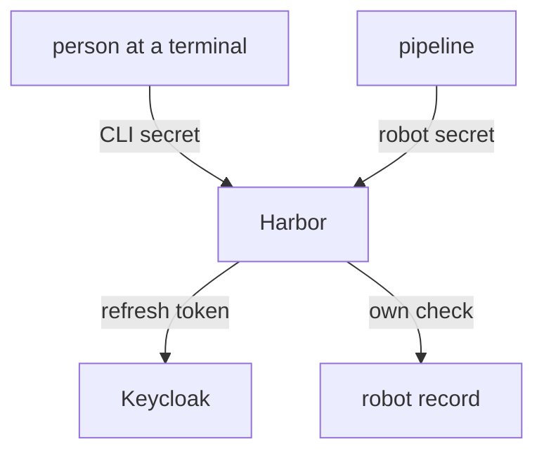

# Tokens, Sessions And CLI Secrets

Access in Harbor has several lifetimes at once: the browser session, the registry token that a client holds for a few minutes, and the CLI secret that a client keeps for months. This part names each one, shows how an administrator replaces a CLI secret, and explains why automation should not use a person's CLI secret at all.

## Three lifetimes

The **session** is the cookie the browser holds after the callback. It lets the person use the portal. The **registry token** is a short token that Harbor core gives to a registry client after a sign-in with a user name and a secret. Its lifetime is the system setting `token_expiration`, in minutes, which is 30 by default. When a long push passes that time, the client asks for a new token, which works only as long as the secret is still valid.

The **CLI secret** is the password of an OIDC user for registry clients. It does not expire by time. Harbor ties it to the user's OIDC session: it works as long as Harbor can refresh the user's tokens at the provider. Read the registry token setting:

<!-- astrona:playground:renew -->

```sh
ws() { kubectl -n workstation exec -i deploy/workstation -- "$@"; }
ws sh -c 'curl -s -u admin:Harbor12345 https://harbor.localtest.me:8443/api/v2.0/configurations | jq "{token_expiration, oidc_auto_onboard, oidc_admin_group}"'
```

The answer shows the three values. `token_expiration` is the registry token lifetime, and the other two come from the OIDC settings.

## Setting a new CLI secret

A user can generate a new CLI secret in the portal, from the user profile. A system administrator can also set one for a user through the REST API, which helps when a user is locked out of the portal. The user must have signed in once so that the OIDC user record exists. Find the numeric ID of `alice`:

```sh
ws sh -c 'curl -s -u admin:Harbor12345 "https://harbor.localtest.me:8443/api/v2.0/users/search?username=alice" | jq ".[] | {user_id, username}"'
```

Save this as `cli-secret.json`. The secret must have 8 to 128 characters with at least one uppercase letter, one lowercase letter and one digit:

```json
{ "secret": "AliceCli2026" }
```

Send it, using the user ID in place of `<USER_ID>`:

```sh
ws curl -s -o /dev/null -w '%{http_code}\n' -u admin:Harbor12345 -X PUT -H 'Content-Type: application/json' --data-binary @- https://harbor.localtest.me:8443/api/v2.0/users/<USER_ID>/cli_secret < cli-secret.json
```

A success code means the old secret stops working and the new one is valid. The user still has exactly one secret. Setting a secret for a user means that you know it, so use this call only for recovery and tell the user to generate a new one at once.

## When the secret stops working

Two events end a CLI secret without anybody touching it. If the user is disabled or deleted in the provider, Harbor can no longer refresh the user's tokens, and registry sign-ins fail. If the provider is not reachable, the same happens. In both cases, the portal sign-in tells the cause: after the user signs in through the browser again, the secret works again.

This behaviour is useful for people, because disabling a person at the provider also ends command-line access. It is a problem for automation, because a pipeline cannot sign in through a browser.

## Why pipelines use robot accounts

A CLI secret belongs to a person. If the person leaves, the pipeline stops. If the pipeline leaks the secret, the secret gives all the rights of that person, in every project. A robot account has none of these problems: it has an explicit list of actions, an expiry and no link to the provider. Use CLI secrets for people at a terminal, and robot accounts for programs.



The diagram shows that a CLI secret depends on the provider, and a robot secret is checked by Harbor alone.

You now know the three lifetimes, how to replace a CLI secret and why automation should not use one. The open question is how to find the cause when a sign-in fails.

## Common pitfalls

> [!WARNING]
> - **Using a person's CLI secret in a pipeline.** The pipeline breaks when the person is disabled.
> - **Setting a secret for a user and keeping it.** Use the call for recovery only.
> - **A secret that does not meet the rules.** It needs 8 to 128 characters with an uppercase letter, a lowercase letter and a digit.
> - **Treating `token_expiration` as the secret lifetime.** It is only the lifetime of the short registry token.
