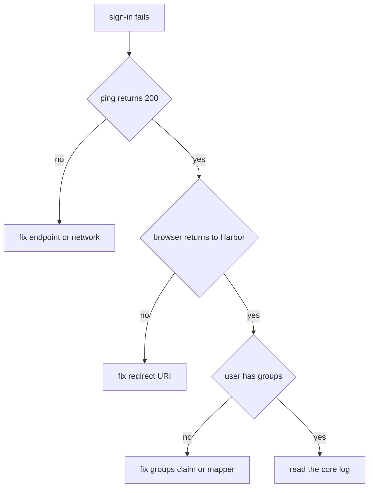

# Troubleshooting OIDC Sign-In

When sign-in breaks, the symptom usually points to one step of the flow. This part gives a method: find the step from what you see, test that step on its own, and read the Harbor core log for the reason. It lists the faults you meet most often.

## A method

The OIDC flow has four steps. Harbor redirects the browser to the provider, the provider checks the password and sends a code, Harbor exchanges the code for tokens, and Harbor reads the claims. Ask three questions. Does the browser reach the provider? Does the browser come back to Harbor? Does Harbor create or find the user with the right groups? The first failing question tells you which side to fix.

## Test the endpoint from Harbor

The first test does not need a browser. Harbor can test an endpoint from its own core component. A `200` proves that Harbor, and not only your browser, reaches the provider:

<!-- astrona:playground:renew -->

```sh
ws() { kubectl -n workstation exec -i deploy/workstation -- "$@"; }
ws curl -s -o /dev/null -w '%{http_code}\n' -u admin:Harbor12345 -H 'Content-Type: application/json' -d '{"url":"http://keycloak.localtest.me:8180/realms/harbor","verify_cert":false}' https://harbor.localtest.me:8443/api/v2.0/system/oidc/ping
```

Change the realm name in the URL to one that does not exist and run the command again. The answer is an error code instead of `200`. A failing ping points at the endpoint, the network or the certificate.

## Read the Harbor core log

Harbor core writes a log line for each failure of the callback. Read the end of the log right after a failed sign-in:

```sh
kubectl -n harbor logs deploy/harbor-core --tail=50
```

Look for lines that mention `oidc`. They name the step that failed, for example the code exchange or the token verification. Copy the exact text into a search; do not guess from the portal message, because the portal shows a short message and the log holds the reason.

## Common faults and what you see

Match the symptom to the likely cause:

| What you see | Likely cause | Where to fix |
| --- | --- | --- |
| Keycloak shows an invalid redirect error | The redirect URI in the client differs from Harbor's address, for example the port is missing | Keycloak client |
| Harbor shows an error after the browser returns | The client secret in Harbor is wrong, or the issuer differs | Harbor settings |
| Sign-in works, but the user has no project access | The groups claim name in Harbor differs from the mapper claim, or the group is not a project member | Harbor settings, mapper |
| Sign-in fails for a new user only | Automatic onboarding is off, or the username claim is not in the token | Harbor settings, mapper |
| The browser cannot reach Keycloak | The address is not resolvable from the browser | Port-forward, hosts file |
| Registry sign-in fails, portal works | The user uses the provider password instead of the CLI secret | The client command |
| Registry sign-in stopped after months | The user is disabled in the provider | The provider |

## Fix one thing at a time

Change one setting, test, and look at the log again. Harbor applies the OIDC settings without a restart, so you can repeat the sign-in at once. When you change the client in Keycloak, use `kcadm update` or the console and then repeat. Do not change the endpoint and the groups claim in the same step, because you will not know which one fixed the problem.



The diagram shows the order of the checks: endpoint first, redirect second, claims third and the log last.

You now have a method for a broken OIDC sign-in: test the endpoint from Harbor, locate the failing step, read the log and change one thing at a time. Together with the group mappings and the lifetimes of secrets, that covers the daily work of running OIDC sign-in.

## Common pitfalls

> [!WARNING]
> - **Testing only in a browser.** A browser cannot show whether Harbor itself reaches the provider.
> - **Changing several settings at once.** You cannot tell which change fixed it.
> - **Ignoring the core log.** The portal message is short; the log has the reason.
> - **Fixing Harbor when the fault is in the client.** A redirect error shown by Keycloak is fixed in Keycloak.
