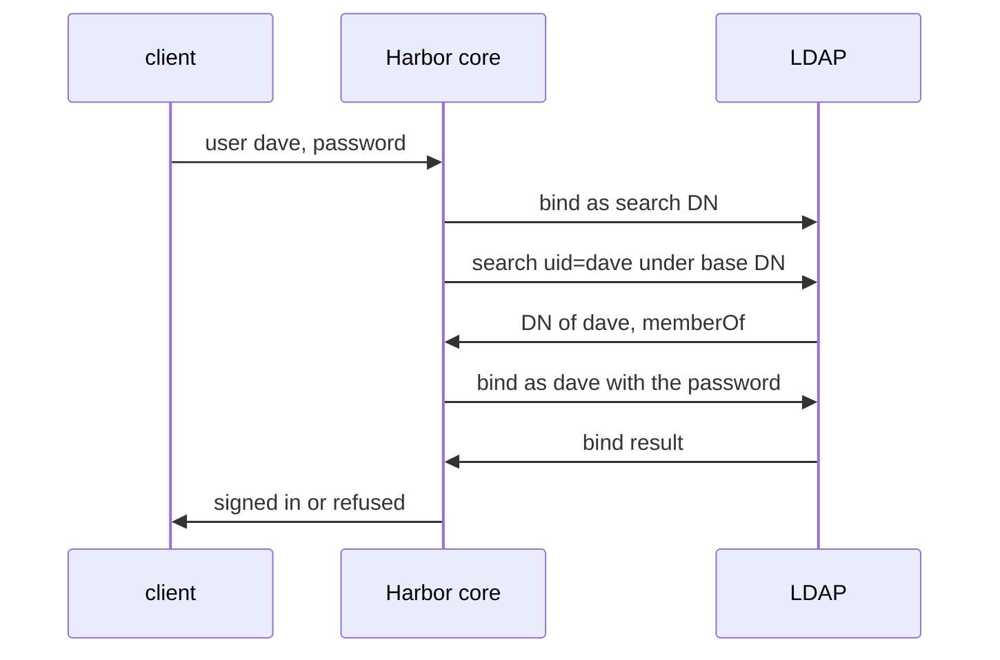

# LDAP Settings And Testing The Connection

Harbor never stores an LDAP user's password. It searches the directory for the user, signs in to the directory as that user to check the password, and reads what it needs. Every one of those steps uses a setting, and one wrong value stops all sign-ins. This part looks at the directory first, then tests Harbor's settings against it without saving anything.

## Looking at the directory

Start with the directory itself. `ldapsearch` is a client that searches an LDAP directory, and it is installed in the OpenLDAP pod. Search for `dave` and ask for two attributes, his full name and his groups:

<!-- astrona:playground:renew -->

```sh
kubectl -n ldap exec deploy/openldap -- ldapsearch -x -H ldap://localhost -D cn=admin,dc=example,dc=org -w admin-password -b dc=example,dc=org '(uid=dave)' cn memberOf
```

`-D` and `-w` bind as the directory administrator, `-b` is the place to start searching, and `(uid=dave)` is an **LDAP filter**, a condition in brackets. The answer is one entry with the DN `uid=dave,ou=people,dc=example,dc=org`, the `cn` `Dave Example`, and a `memberOf` attribute with the value `cn=inventory-devs,ou=groups,dc=example,dc=org`. The directory's **memberOf overlay** writes that attribute on each user who is a `member` of a group, and Harbor reads it to find the user's groups.

## The settings Harbor needs

Harbor finds and checks a user in four steps, and each step has a setting:

| Step | Setting | API key | Value here |
| --- | --- | --- | --- |
| Connect to the directory | LDAP URL | `ldap_url` | `ldap://openldap.ldap.svc.cluster.local:389` |
| Sign in to search | Search DN and password | `ldap_search_dn`, `ldap_search_password` | `cn=admin,dc=example,dc=org`, `admin-password` |
| Find the user | Base DN, filter, UID, scope | `ldap_base_dn`, `ldap_filter`, `ldap_uid`, `ldap_scope` | `ou=people,dc=example,dc=org`, `(objectClass=inetOrgPerson)`, `uid`, `2` |
| Check the password | (a bind as the found DN) | | |

The **base DN** is where Harbor starts searching for users. The **filter** limits the search to user entries. The **UID** is the attribute that must equal the name typed at sign-in; it is `uid` in OpenLDAP and often `sAMAccountName` in Active Directory. The **scope** is how deep to search under the base DN: `0` the base only, `1` one level, `2` the whole subtree. With these values, the sign-in name `dave` turns into the search `(&(objectClass=inetOrgPerson)(uid=dave))` under `ou=people,dc=example,dc=org`.

## Testing before saving

The `harbor` CLI can test LDAP settings without saving them. `harbor ldap ping` takes the settings as flags and asks Harbor's `core` to bind to the directory with them:

```sh
ws() { kubectl -n workstation exec -i deploy/workstation -- "$@"; }
echo Harbor12345 | ws harbor login https://harbor.localtest.me:8443 --username admin --password-stdin
ws harbor ldap ping --ldap-url ldap://openldap.ldap.svc.cluster.local:389 --ldap-search-dn cn=admin,dc=example,dc=org --ldap-password admin-password --ldap-base-dn ou=people,dc=example,dc=org --ldap-filter '(objectClass=inetOrgPerson)' --ldap-uid uid --ldap-scope 2
```

The CLI reports that the connection works. Run it again with `--ldap-password wrong` and it reports a failure: the search DN could not bind. The test runs inside Harbor, not in the workstation, so it proves that Harbor's `core` reaches the directory at that URL.



The diagram shows one LDAP sign-in: Harbor searches with its own account, then binds as the user to check the password, so the password is only ever checked by the directory.

## Directory and security

The search DN here is the directory administrator, to keep the lab small. In a real directory, use a read-only service account that can search users and groups and nothing else. Use `ldaps://` with certificate verification on, so passwords never cross the network in clear text; this lab runs plain `ldap://` inside the cluster and turns verification off.

You now know how Harbor finds and checks an LDAP user, the settings for each step, and how to test them before saving. The open question is how Harbor finds the user's groups, and how those groups become project access.

## Common pitfalls

> [!WARNING]
> - **The wrong UID attribute.** `uid` in OpenLDAP, often `sAMAccountName` in Active Directory. With the wrong one, no user is ever found.
> - **A base DN that does not contain the users.** Harbor searches only below it; users elsewhere cannot sign in.
> - **A filter without brackets.** An LDAP filter is always written in brackets, such as `(objectClass=inetOrgPerson)`.
> - **Saving settings without a test.** `harbor ldap ping` finds a wrong URL, DN or password before any user is locked out.
