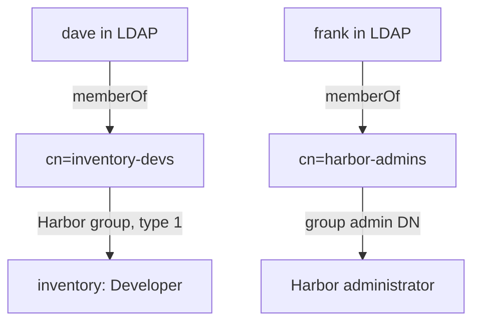

# LDAP Users, Groups And Project Membership

A working sign-in only proves that Harbor can find a user. Access should come from the directory's groups, so that adding someone to `inventory-devs` in the directory is all it takes to let them push. This part switches Harbor to LDAP with the group settings, makes one LDAP group a project member and another the administrators, and proves both with pushes.

## The group settings

Harbor needs four more settings to work with groups:

| Setting | API key | Value here |
| --- | --- | --- |
| Group base DN | `ldap_group_base_dn` | `ou=groups,dc=example,dc=org` |
| Group filter | `ldap_group_search_filter` | `(objectClass=groupOfNames)` |
| Group name attribute (group GID) | `ldap_group_attribute_name` | `cn` |
| Group membership attribute | `ldap_group_membership_attribute` | `memberof` |
| Group admin DN | `ldap_group_admin_dn` | `cn=harbor-admins,ou=groups,dc=example,dc=org` |

The **group base DN** and **group filter** tell Harbor where groups live and which entries are groups; OpenLDAP uses `groupOfNames`, Active Directory uses `group`. The **group membership attribute** is the attribute on the user entry that lists the user's groups, `memberof`, filled in by the directory. Every member of the group in the **group admin DN** becomes a Harbor system administrator.

## Switching Harbor to LDAP

The authentication mode can change only while Harbor holds no users except `admin`, which is true in this playground. Save all settings as `harbor-ldap.json`:

<!-- astrona:playground:renew -->

```json
{
  "auth_mode": "ldap_auth",
  "ldap_url": "ldap://openldap.ldap.svc.cluster.local:389",
  "ldap_search_dn": "cn=admin,dc=example,dc=org",
  "ldap_search_password": "admin-password",
  "ldap_base_dn": "ou=people,dc=example,dc=org",
  "ldap_filter": "(objectClass=inetOrgPerson)",
  "ldap_uid": "uid",
  "ldap_scope": 2,
  "ldap_verify_cert": false,
  "ldap_group_base_dn": "ou=groups,dc=example,dc=org",
  "ldap_group_search_filter": "(objectClass=groupOfNames)",
  "ldap_group_attribute_name": "cn",
  "ldap_group_search_scope": 2,
  "ldap_group_membership_attribute": "memberof",
  "ldap_group_admin_dn": "cn=harbor-admins,ou=groups,dc=example,dc=org"
}
```

Apply it, and test the saved settings with an empty `ping`, which uses Harbor's current configuration:

```sh
ws() { kubectl -n workstation exec -i deploy/workstation -- "$@"; }
ws curl -s -u admin:Harbor12345 -X PUT -H 'Content-Type: application/json' --data-binary @- https://harbor.localtest.me:8443/api/v2.0/configurations < harbor-ldap.json
ws curl -s -o /dev/null -w '%{http_code}\n' -u admin:Harbor12345 -X POST -H 'Content-Type: application/json' -d '{}' https://harbor.localtest.me:8443/api/v2.0/ldap/ping
```

The `ping` returns `200`. Now look a user up through Harbor, which proves the user search works end to end:

```sh
echo Harbor12345 | ws harbor login https://harbor.localtest.me:8443 --username admin --password-stdin
ws harbor ldap search dave
```

The answer shows `dave` with his DN and email, found in the directory by Harbor. Nothing is created in Harbor yet: an LDAP user is **onboarded**, created in Harbor's database, at the first sign-in or when the administrator imports the user with `harbor ldap import dave`.

## An LDAP group as a project member

Add the group to `inventory`. LDAP groups have the group type `1`, and Harbor identifies them by their DN:

```sh
ws harbor project member create inventory --groupname inventory-devs --grouptype 1 --ldapdn cn=inventory-devs,ou=groups,dc=example,dc=org --role Developer
ws sh -c 'curl -s -u admin:Harbor12345 https://harbor.localtest.me:8443/api/v2.0/projects/inventory/members | jq -r ".[] | [.entity_name, .entity_type, .role_id] | @tsv"'
```

The list shows `inventory-devs` as a group (`g`) with role `2`, Developer. When a user signs in, Harbor reads the DNs in the user's `memberof` attribute and gives the user every role that a group with one of those DNs has.

## Proving it with pushes

LDAP users need no CLI secret: `oras` signs in with the directory password, and Harbor checks it with a bind. Push as `dave`, who is in the group, and as `erin`, who is not:

```sh
echo DavePass1 | ws oras login --registry-config /tmp/dave.json -u dave --password-stdin harbor.localtest.me:8443
ws sh -c 'cd /tmp && date > note.txt && oras push --registry-config /tmp/dave.json harbor.localtest.me:8443/inventory/app:dave note.txt'
echo ErinPass1 | ws oras login --registry-config /tmp/erin.json -u erin --password-stdin harbor.localtest.me:8443
ws sh -c 'cd /tmp && oras push --registry-config /tmp/erin.json harbor.localtest.me:8443/inventory/app:erin note.txt'
```

Both sign-ins work, because both users exist in the directory. `dave`'s push succeeds and `erin`'s is refused: the group membership, not the sign-in, decides access. Both users now exist in Harbor, onboarded at their first sign-in.



The diagram shows both paths: a group DN that is a project member gives a project role, and the group admin DN gives system administrator rights.

## The admin group

`frank` is in `harbor-admins`, the group admin DN. Ask Harbor who `frank` is, signed in as `frank` with his directory password:

```sh
ws sh -c 'curl -s -u frank:FrankPass1 https://harbor.localtest.me:8443/api/v2.0/users/current | jq "{username, sysadmin_flag, admin_role_in_auth}"'
```

`admin_role_in_auth` is `true`: `frank` is a system administrator because of his LDAP group, not because of a flag stored in Harbor. Removing him from `harbor-admins` in the directory removes the rights at his next sign-in.

You can now switch Harbor to LDAP, test the settings, map an LDAP group to a project role, set the admin group, and prove access with the users' own passwords. The directory now decides who may push.

## Common pitfalls

> [!WARNING]
> - **The group membership attribute set to something the directory does not fill.** No user is ever in any group, and every group membership is ignored.
> - **A group filter for the wrong kind of directory.** `groupOfNames` in OpenLDAP, `group` in Active Directory.
> - **A group DN with a typo.** Harbor stores the DN you give it; no user's `memberof` will ever match it.
> - **Expecting a CLI secret.** LDAP users sign registry clients in with their directory password.

## Your mission: Give An LDAP Group Developer Access

You can now configure LDAP sign-in with groups, test it, and map groups to project roles and administrator rights. The graded lab gives you a Harbor still on database authentication and the same directory, and asks you to make the group `inventory-devs` Developers of `inventory` and `harbor-admins` the administrators.

The lab runs in its own cluster, so first pause your playground. Nothing in it is lost:

```sh
astrona stop ats-101-playground-040-01
```

Then start the lab:

```sh
astrona run --git ssh://git@github.com/astrona-io/ATS101.git -c sections/section-040/module-01/labs/lab-01
```

The task is on the next page. Solve it on your own first. When you think you are done, send it for grading:

```sh
astrona submit -c sections/section-040/module-01/labs/lab-01
```

When the lab is done, remove it and start your playground again:

```sh
astrona destroy ats-101-lab-040-01
astrona start ats-101-playground-040-01
```
