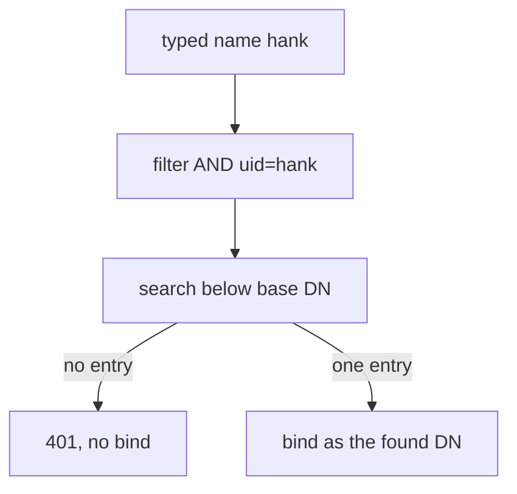

# Choosing The User Search And Filter

Every person who can sign in to Harbor through LDAP is a person the search can find. If the search finds everyone in the directory, then contractors and service accounts can sign in too, and they only need to be in a project to push. This part shows how the search is built, what the scope does, and how to narrow the filter so that one class of users is left out.

## How Harbor builds the search

At sign-in, Harbor takes the name typed by the user and builds one filter: the configured filter and the UID test, joined with `&`, which means both must be true. For the name `dave`, the UID `uid` and the filter `(objectClass=inetOrgPerson)`, the search is `(&(objectClass=inetOrgPerson)(uid=dave))`. Harbor runs it below the base DN. If the search returns exactly one entry, Harbor binds as that entry's DN with the typed password.

You can run the same search yourself against the directory. Search for `hank` and ask for his type of employment:

<!-- astrona:playground:renew -->

```sh
kubectl -n ldap exec deploy/openldap -- ldapsearch -x -H ldap://localhost -D cn=admin,dc=example,dc=org -w admin-password -b ou=people,dc=example,dc=org '(&(objectClass=inetOrgPerson)(uid=hank))' uid employeeType
```

The answer is one entry for `hank` with `employeeType` set to `contractor`. The attribute `employeeType` is a standard attribute of the class `inetOrgPerson`, and here the directory uses it to mark contractors.

## Filter syntax

An LDAP filter is always in brackets, and the operator comes first. `&` means and, `|` means or, `!` means not, and the comparison is `attribute=value`. To select all people who are not contractors:

```text
(&(objectClass=inetOrgPerson)(!(employeeType=contractor)))
```

Test this filter in the directory before you give it to Harbor. Combine it with a UID test, as Harbor will do:

```sh
kubectl -n ldap exec deploy/openldap -- ldapsearch -x -H ldap://localhost -D cn=admin,dc=example,dc=org -w admin-password -b ou=people,dc=example,dc=org '(&(&(objectClass=inetOrgPerson)(!(employeeType=contractor)))(uid=hank))' uid
```

The search returns no entry. With `uid=dave` in place of `hank`, it returns one entry, because `dave` has no `employeeType`. An entry that lacks the attribute is not a contractor, so the `!` test is true for it.

## The scope

The **scope** says how deep below the base DN the search looks. `0` (base) looks at the base entry only. `1` (one level) looks at its direct children only. `2` (subtree) looks at the base entry and everything below it. Harbor's setting `ldap_scope` takes these numbers. If users are spread over several organisational units below `ou=people`, use `2`. If they are all direct children, `1` is faster and cannot find an entry that you did not mean.

## Changing the filter in Harbor

Test the new settings without saving them. The `ping` call takes the filter in its body and tests the bind:

```sh
ws() { kubectl -n workstation exec -i deploy/workstation -- "$@"; }
ws curl -s -o /dev/null -w '%{http_code}\n' -u admin:Harbor12345 -X POST -H 'Content-Type: application/json' -d '{"ldap_url":"ldap://openldap.ldap.svc.cluster.local:389","ldap_search_dn":"cn=admin,dc=example,dc=org","ldap_search_password":"admin-password","ldap_base_dn":"ou=people,dc=example,dc=org","ldap_filter":"(&(objectClass=inetOrgPerson)(!(employeeType=contractor)))","ldap_uid":"uid","ldap_scope":2}' https://harbor.localtest.me:8443/api/v2.0/ldap/ping
```

A `200` means that Harbor binds to the directory with these settings. Note what `ping` does not test: it checks the connection and the bind, not the filter's effect on users. To change the filter, save this as `ldap-filter.json`:

```json
{ "ldap_filter": "(&(objectClass=inetOrgPerson)(!(employeeType=contractor)))" }
```

```sh
ws curl -s -u admin:Harbor12345 -X PUT -H 'Content-Type: application/json' --data-binary @- https://harbor.localtest.me:8443/api/v2.0/configurations < ldap-filter.json
```

Prove the effect with a sign-in as `hank`. Harbor answers `401`, because its search finds no entry:

```sh
ws curl -s -o /dev/null -w '%{http_code}\n' -u hank:HankPass1 https://harbor.localtest.me:8443/api/v2.0/users/current
```

Run the same command as `dave` with `DavePass1` and the answer is `200`.



The diagram shows that a user who the search cannot find never reaches the password check.

You now know how the search is built and how a filter keeps a class of users out. The open question is how to give the groups of the people who remain different levels of access.

## Common pitfalls

> [!WARNING]
> - **A filter without brackets.** Every filter, and every part of a combined filter, is in brackets.
> - **Using `ping` as proof that the filter works.** It tests the bind only; sign in as a user to test the filter.
> - **A negative test on an attribute that most entries lack.** It is true for those entries, which is usually what you want, but check it with `ldapsearch`.
> - **Scope `0`.** It searches only the base entry, so no user is found.
