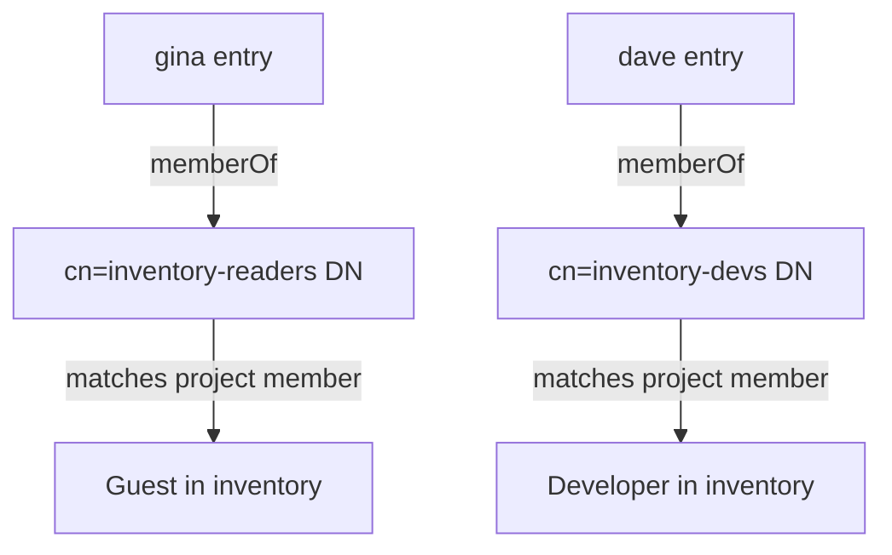

# Group Roles In Projects

A directory group is useful in Harbor only after it is a project member. This part searches the directory for groups through Harbor, adds two groups to one project with different roles, and proves the roles with real pushes and pulls.

## Searching for groups through Harbor

Harbor can search the directory for groups with the group settings it already has: the group base DN, the filter and the name attribute. The call returns the name and DN of each group it finds. Search for groups with `inventory` in the name:

<!-- astrona:playground:renew -->

```sh
ws() { kubectl -n workstation exec -i deploy/workstation -- "$@"; }
ws sh -c 'curl -s -u admin:Harbor12345 "https://harbor.localtest.me:8443/api/v2.0/ldap/groups/search?groupname=inventory" | jq -r ".[] | [.ldap_group_name, .ldap_group_dn] | @tsv"'
```

The answer shows two groups, `inventory-devs` and `inventory-readers`, each with its DN, such as `cn=inventory-devs,ou=groups,dc=example,dc=org`. The DN is what Harbor stores for an LDAP group, because the name alone is not unique in a directory with several branches.

## Two roles in one project

The project `inventory` should be writable by `inventory-devs` and readable by `inventory-readers`. Members of the first group need Developer, which can push and pull. Members of the second need Guest, which can pull only. Save this as `member-devs.json`:

```json
{
  "role_id": 2,
  "member_group": {
    "group_name": "inventory-devs",
    "group_type": 1,
    "ldap_group_dn": "cn=inventory-devs,ou=groups,dc=example,dc=org"
  }
}
```

Save this as `member-readers.json`:

```json
{
  "role_id": 3,
  "member_group": {
    "group_name": "inventory-readers",
    "group_type": 1,
    "ldap_group_dn": "cn=inventory-readers,ou=groups,dc=example,dc=org"
  }
}
```

The group type `1` means an LDAP group. Send both and read the members back:

```sh
ws curl -s -u admin:Harbor12345 -X POST -H 'Content-Type: application/json' --data-binary @- https://harbor.localtest.me:8443/api/v2.0/projects/inventory/members < member-devs.json
ws curl -s -u admin:Harbor12345 -X POST -H 'Content-Type: application/json' --data-binary @- https://harbor.localtest.me:8443/api/v2.0/projects/inventory/members < member-readers.json
ws sh -c 'curl -s -u admin:Harbor12345 https://harbor.localtest.me:8443/api/v2.0/projects/inventory/members | jq -r ".[] | [.entity_name, .entity_type, .role_id] | @tsv"'
```

The list has two lines with the type `g`, role `2` for `inventory-devs` and role `3` for `inventory-readers`.

## Proving the roles

Sign in as `dave`, who is in the developers group, and as `gina`, who is in the readers group. Push as each, then pull the artifact as `gina`:

```sh
echo DavePass1 | ws oras login --registry-config /tmp/dave.json -u dave --password-stdin harbor.localtest.me:8443
echo GinaPass1 | ws oras login --registry-config /tmp/gina.json -u gina --password-stdin harbor.localtest.me:8443
ws sh -c 'cd /tmp && date > note.txt && oras push --registry-config /tmp/dave.json harbor.localtest.me:8443/inventory/app:dave note.txt'
ws sh -c 'cd /tmp && oras push --registry-config /tmp/gina.json harbor.localtest.me:8443/inventory/app:gina note.txt'
ws sh -c 'cd /tmp && oras pull --registry-config /tmp/gina.json harbor.localtest.me:8443/inventory/app:dave'
```

The first push succeeds. The second push, by `gina`, is refused, because a Guest cannot push. The pull by `gina` succeeds. Both sign-ins work, which shows again that the group decides access and not the sign-in.

## What Harbor does with the memberOf attribute

When `gina` signs in, Harbor reads the attribute named in `ldap_group_membership_attribute`, here `memberof`, from her directory entry. Each value is the DN of a group. Harbor compares every DN with the LDAP groups that are project members and gives her the matching roles. If the directory does not fill `memberOf`, she has no groups, and the roles above do nothing.



The diagram shows that Harbor matches DNs, so a typing error in the stored DN means no user ever matches.

You now know how to find groups through Harbor, give two groups different roles and prove the difference. The graded lab combines this with the filter from the previous part.

## Common pitfalls

> [!WARNING]
> - **Adding the group by name only.** An LDAP group member needs the group type `1` and the DN.
> - **A DN with a typo.** Harbor stores what you send, and no user's `memberOf` will match.
> - **Assuming a Guest can push.** A Guest pulls only.
> - **Expecting Harbor to refresh groups during a session.** Harbor reads `memberOf` at sign-in.

## Your mission: Narrow The LDAP Filter And Give Two Groups Different Roles

You can now narrow who can sign in and map two groups to different roles. The graded lab gives you a Harbor already in LDAP mode, and asks you to keep contractors out with the user filter and to make two groups Developers and Guests of the project `inventory`.

The lab runs in its own cluster, so first pause your playground. Nothing in it is lost:

```sh
astrona stop ats-101-playground-040-02
```

Then start the lab:

```sh
astrona run --git ssh://git@github.com/astrona-io/ATS101.git -c sections/section-040/module-02/labs/lab-01
```

The task is on the next page. Solve it on your own first. When you think you are done, send it for grading:

```sh
astrona submit -c sections/section-040/module-02/labs/lab-01
```

When the lab is done, remove it and start your playground again:

```sh
astrona destroy ats-101-lab-040-02
astrona start ats-101-playground-040-02
```
