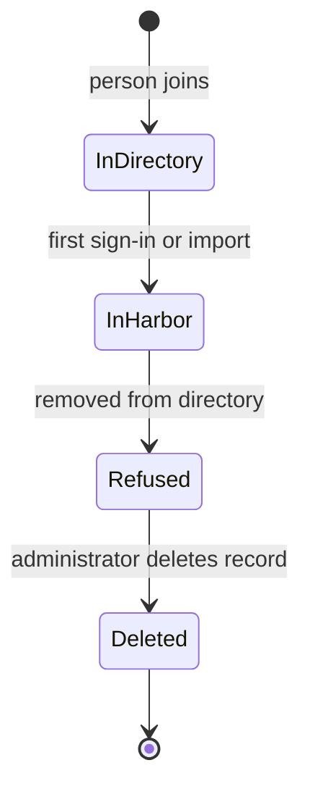

# Importing Users And Offboarding

A directory user becomes a Harbor user in one of two ways, and a user who leaves the directory does not disappear from Harbor by itself. This part covers onboarding at first sign-in, importing users ahead of time, and what to do with the Harbor record when the person leaves.

## Onboarding at the first sign-in

The first time a directory user signs in, Harbor creates a record in its own database with the name, the email address and the directory DN. The password is never stored. From then on the user appears in Harbor's user list, can be a project member by name, and can be made a system administrator by a flag. Until the first sign-in, Harbor knows nothing about the user.

That is a problem when you want to add a person to a project before the person has signed in. Harbor cannot add a member it has no record for.

## Searching and importing

An administrator can import users, which creates the records without a sign-in. First, find the user through Harbor, which searches the directory with the current settings:

<!-- astrona:playground:renew -->

```sh
ws() { kubectl -n workstation exec -i deploy/workstation -- "$@"; }
ws sh -c 'curl -s -u admin:Harbor12345 "https://harbor.localtest.me:8443/api/v2.0/ldap/users/search?username=erin" | jq .'
```

The answer holds the user name, the real name and the email address that the directory has for `erin`. Nothing is created yet. To create the record, save this as `ldap-import.json`:

```json
{ "ldap_uid_list": ["erin"] }
```

Send it to the import endpoint and list the users:

```sh
ws curl -s -u admin:Harbor12345 -X POST -H 'Content-Type: application/json' --data-binary @- https://harbor.localtest.me:8443/api/v2.0/ldap/users/import < ldap-import.json
ws sh -c 'curl -s -u admin:Harbor12345 "https://harbor.localtest.me:8443/api/v2.0/users?page_size=100" | jq -r ".[].username"'
```

The list now holds `erin` next to `admin`. She can be added to projects by name.

## What happens when a person leaves

Suppose `erin` leaves the company and the directory team deletes her entry. At her next sign-in, Harbor's search finds nothing and refuses her. Her Harbor record stays. Her project memberships stay. Anything she created, such as robot accounts in projects she managed, stays too. The directory ends her ability to authenticate, and Harbor does not clean up on its own.

If the person only moves to a contractor class that your filter excludes, the same holds: the sign-in is refused, and the record stays.

## Cleaning the Harbor record

An administrator removes the record with the user API. Find the numeric ID of `erin` and delete it:

```sh
ws sh -c 'curl -s -u admin:Harbor12345 "https://harbor.localtest.me:8443/api/v2.0/users/search?username=erin" | jq ".[] | {user_id, username}"'
ws curl -s -o /dev/null -w '%{http_code}\n' -u admin:Harbor12345 -X DELETE https://harbor.localtest.me:8443/api/v2.0/users/<USER_ID>
```

Replace `<USER_ID>` with the number from the first command. Harbor removes the user from the project member lists and marks the record deleted, so the name is not reused by accident. The artifacts that the person pushed stay in the projects, because they belong to the project and not to the person.

## A routine for leavers

A short routine keeps the user list honest. When the directory removes a person, remove the Harbor record on the same day. List the robot accounts the person created in their projects and check each one. Once a quarter, compare the Harbor user list with the directory and remove the users who no longer exist there.



The diagram shows that the directory controls sign-in, and the Harbor record needs a separate deletion.

You now know how a directory user enters Harbor, how to import ahead of a sign-in, and why a leaver needs a manual clean-up. The open question is how to find the cause when LDAP sign-in fails.

## Common pitfalls

> [!WARNING]
> - **Adding a member who has never signed in.** Harbor has no record; import the user first.
> - **Assuming Harbor cleans up when the directory entry disappears.** The record and the memberships stay.
> - **Forgetting robot accounts of a leaver.** They keep working until someone removes them.
> - **Expecting the artifacts to go with the user.** They stay in the project.
