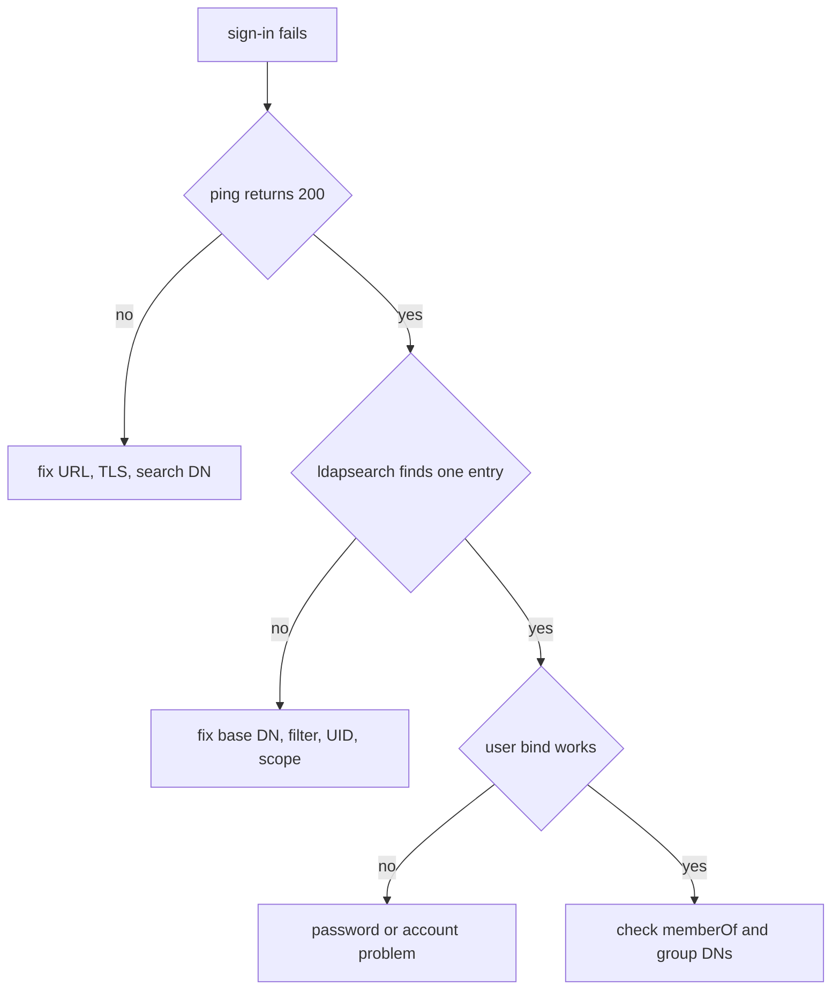

# Troubleshooting LDAP Sign-In

When LDAP sign-in fails, the cause is one of a few things: Harbor cannot connect, the search finds no entry, the bind fails, or the groups are empty. This part gives a method that checks each in order, with a test on the directory side and a test on the Harbor side for every step.

## A method

LDAP sign-in has four steps. Harbor connects to the directory. Harbor binds with the search DN and password. Harbor searches for the user. Harbor binds as the found DN with the typed password. Test them in this order, because each depends on the one before. Run the same step by hand with `ldapsearch` first, and only then blame Harbor.

## Connect and bind as the search DN

The `ping` call tests the first two steps from Harbor's own core component. With an empty body it uses the saved settings:

<!-- astrona:playground:renew -->

```sh
ws() { kubectl -n workstation exec -i deploy/workstation -- "$@"; }
ws curl -s -o /dev/null -w '%{http_code}\n' -u admin:Harbor12345 -X POST -H 'Content-Type: application/json' -d '{}' https://harbor.localtest.me:8443/api/v2.0/ldap/ping
```

`200` means Harbor connected and bound. Any other code means the URL, the network, the TLS setting, the search DN or the search password is wrong. Send the same request with `"ldap_search_password":"wrong"` in the body and read the difference.

## Search and bind as the user

If `ping` works, test the search from the directory side with the search DN and the exact filter Harbor builds, as in `(&(objectClass=inetOrgPerson)(uid=dave))`. No entry means the base DN, the scope, the filter or the UID attribute is wrong. Two entries mean the filter is too wide, and Harbor refuses to guess. Then test the user's password by binding as the user:

```sh
kubectl -n ldap exec deploy/openldap -- ldapwhoami -x -H ldap://localhost -D uid=dave,ou=people,dc=example,dc=org -w DavePass1
```

The answer is the DN of the user. If this fails, the password is wrong or the account is locked in the directory, and Harbor cannot help.

## Empty groups

If the sign-in works and the user has no project access, check the groups. Read the `memberOf` attribute of the user in the directory:

```sh
kubectl -n ldap exec deploy/openldap -- ldapsearch -x -H ldap://localhost -D cn=admin,dc=example,dc=org -w admin-password -b ou=people,dc=example,dc=org '(uid=dave)' memberOf
```

If `memberOf` is empty, the directory does not fill it, and Harbor sees no groups. In this OpenLDAP image, the overlay fills it only for groups of class `groupOfUniqueNames`. If the attribute has values but access is missing, compare each DN with the DN stored for the project member, character by character.

## TLS and timeouts

A production directory uses `ldaps://`, which is LDAP over TLS, or the `StartTLS` command on a normal port. Harbor checks the server certificate when `ldap_verify_cert` is `true`. A directory with a private certificate authority fails that check until the authority is trusted by Harbor, so the sign-in fails even though `ldapsearch` works from your laptop. Harbor also stops waiting for a slow directory after `ldap_timeout` seconds, with a default of 5. A directory that answers slowly looks like a failure that comes and goes.

Read the Harbor core log for the reason after a failed sign-in:

```sh
kubectl -n harbor logs deploy/harbor-core --tail=50
```

Look for lines that mention LDAP, and compare them with the step that failed.

## Differences in Active Directory

Active Directory uses `sAMAccountName` for the sign-in name, the class `person` or `user` for users, the class `group` for groups, and the attribute `memberOf` on users. The `memberOf` attribute is always filled. Copying OpenLDAP settings to Active Directory, such as `uid` as the UID attribute, is the most common cause of "no user found" there.



The diagram shows the order of the checks: connection first, search second, user bind third and groups last.

You now have a method that tests each step of an LDAP sign-in on its own, so you can tell which side to fix. Together with the filter, the group roles and the clean-up of leavers, that covers the daily work of running LDAP sign-in.

## Common pitfalls

> [!WARNING]
> - **Testing only in Harbor.** Run the step by hand with `ldapsearch` first, so you know whether the directory or Harbor is at fault.
> - **Copying OpenLDAP settings to Active Directory.** The UID attribute, user class and group class differ.
> - **Turning off certificate verification to make it work.** Trust the certificate authority instead.
> - **Ignoring the timeout.** A slow directory looks like a random failure.
